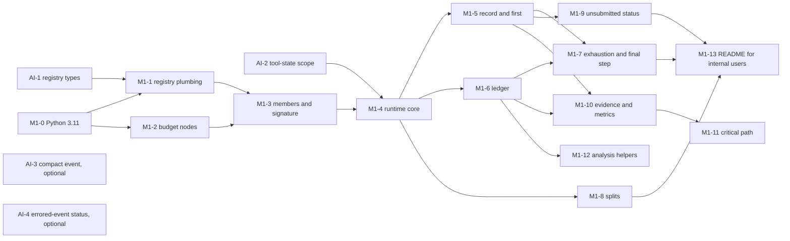
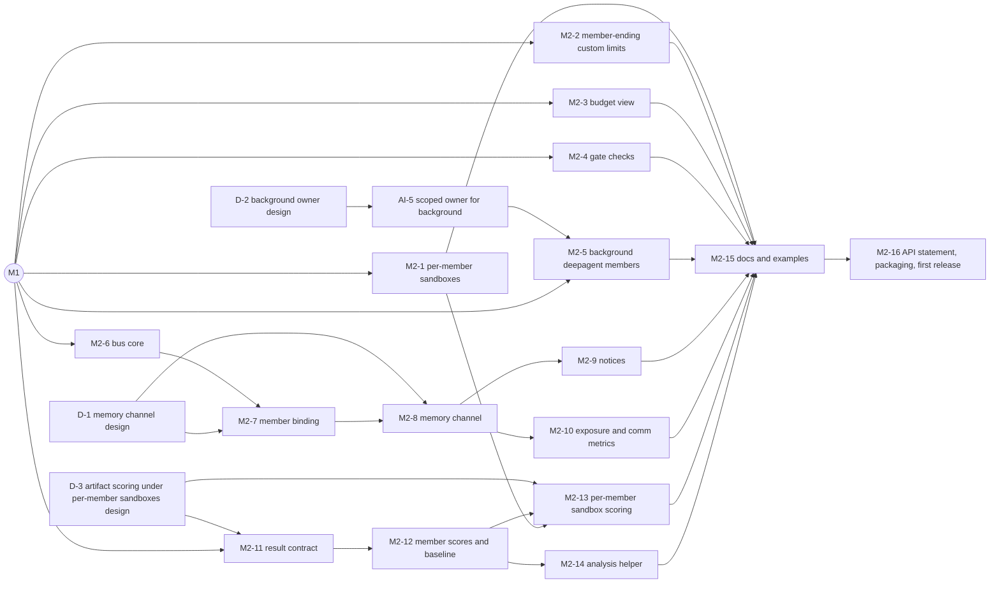

# Inspect Swarm: implementation plan

Status: proposed, 2026-10-13. Issue: none. Author: agent (Claude), reviewed by Codex; see the PR.

## Overview

This is the build plan for inspect_swarm across the merged designs. It is a plan, not a design: each pull request below names the design sections it implements, and nothing here changes what those sections say.

There are two milestones (decision: Ransom, 2026-10-13):

- **M1, ready for first internal usage.** A leaderless swarm over a shared sandbox, with full accounting: the `swarm()` API with registered controllers and channels, per-member tool state, a budget cap that stops members in an orderly way, a ledger of what was actually spent, the final answer `first` with every member's submission recorded, and evidence and metrics in the log. Existing task scorers score it unchanged. Two small inspect_ai pull requests land first: the registry types and the tool-state scope.
- **M2, ready for external usage.** What an external team needs to port its own agent-swarm experiment and gain from it, measured against Epoch's LeanOpenProblems swarm: a sandbox per member, background deepagent members, a shared-memory channel routed through a monitored bus, budget visibility for members, custom limits that end only the member, gate-check metrics, per-member scores and the comparisons with epochs, plus user docs, examples, an API stability statement and a first PyPI release. Direct messages between members, the previous M2, are not needed for that and move to future work, if Ransom agrees ([Open question 2](#open-questions)).

Each milestone is a set of small pull requests. Most are in this repository; three are in inspect_ai, each a separate pull request with its own place in the dependency graph. Neither milestone needs a change in inspect_swe or inspect_sentinel. Everything else in the designs is future work, in any order.

## Why

The designs were written as separate deep dives, each with its own milestone labels and its own implementation plan, and they now disagree in places. Ransom redefined the milestones on 2026-10-13 around two audiences: internal users first, external users next, with Epoch's swarm as the test of the second. Building needs one ordered list of pull requests that says which design text each implements, which can be built at the same time, and what is deliberately left for later.

## Goals and non-goals

Goals:

- Define M1 and M2, deciding where each item the deep dives assigned to a milestone lands, with the reason.
- Break each milestone into pull requests that are as independent as possible, each with its scope, files, tests, dependencies and the design sections it implements, and show which can be built in parallel.
- Identify the inspect_ai, inspect_swe and inspect_sentinel pull requests separately.
- List the future work, one line per item.
- List the gaps and contradictions between the deep dives that planning exposed, and every place where their milestone wording no longer matches this plan.

Non-goals:

- New design. Where a pull request needs a decision no merged design makes, it is an [open question](#open-questions) or a design pull request in the graph, not something this document settles.
- Changing the deep dives. This branch adds this document and replaces the milestone summaries in [swarm-overview.md](swarm-overview.md#plan) and [swarm.md](swarm.md#implementation-plan) with links here. The other deep dives keep their text; [Follow-ups](#follow-ups-milestone-wording-in-the-deep-dives) lists what no longer matches.
- ORBIT (PR #4, an open draft). Future work only.

## Current state

What the plan starts from, checked on 2026-10-13:

- **No runtime code.** `src/inspect_swarm/` holds only `__init__.py` (exporting `__version__` and nothing else), `_version.py` and `py.typed`; `tests/` holds the scaffold's package test.
- **The merged designs:** [swarm-overview.md](swarm-overview.md), [swarm.md](swarm.md), [swarm-api.md](swarm-api.md), [swarm-communication.md](swarm-communication.md) (with its optional push delivery), [swarm-limits.md](swarm-limits.md), [swarm-scoring.md](swarm-scoring.md), [swarm-lean-open-problems.md](swarm-lean-open-problems.md) and [swarm-sandbox-isolation.md](swarm-sandbox-isolation.md).
- **The inspect_ai prerequisites have not landed.** inspect_ai `main`'s `RegistryType` has no `swarm_controller` or `swarm_channel` (`src/inspect_ai/_util/registry.py`), and `inspect_ai.util` has no `tool_state_scope`. This repository's lockfile installs inspect_ai `0.3.278.dev1+gfccfb298e`; the latest inspect_ai release is 0.3.279 (2026-10-12).
- **inspect_sentinel's dispatcher has reached inspect_ai `main`.** `src/inspect_ai/_sentinel/` (with `_dispatch.py`) is on `main`, with commits through 2026-10-12 (#5811, "sentinel monitors can watch every agent's model calls"). swarm-communication.md, citing `feature/sentinel`, says it has not ([inspect_sentinel](swarm-communication.md#inspect_sentinel)). Its tool stages still do not run for bridged agents: `warn_sentinel_bridged()` (`src/inspect_ai/_sentinel/_context.py:57-64`, at `81c1668d3`) warns that bridged agents' tool calls are not monitored, only their model calls (inspect_ai#5759). So the bus's `policy=` hook is still needed for bridged sends ([Open question 5](#open-questions)).
- **The scaffold is still on Python 3.10.** `pyproject.toml` (`requires-python = ">=3.10"`, pyright `pythonVersion = "3.10"`), `AGENTS.md`, `CONTRIBUTING.md` and the CI matrix in `.github/workflows/build.yaml` (`["3.10", "3.14"]`) predate the 3.11 decision (decision: Ransom, 2026-10-07; [swarm.md Compatibility](swarm.md#compatibility-and-migration)).
- **Releases are off.** `.github/workflows/release.yaml` has only `workflow_dispatch`; its comment says to restore the `push` trigger to cut 0.1.0. `release-pin-deps.yml` rewrites the `inspect-ai @ git+...@main` dependency to `inspect-ai>=<latest release>` on the release pull request, so a release needs every inspect_ai change it uses to be in a PyPI release of inspect_ai.
- **Sibling packages' layout for docs and examples.** inspect_sentinel and inspect_flow keep a Quarto site in `docs/` (`_quarto.yml`); inspect_sentinel keeps runnable `examples/`. This repository's `pyproject.toml` already excludes `docs/` from the wheel and from ruff.

## Milestones

### M1: ready for first internal usage

M1 is swarm.md's current M1, largely unchanged: a leaderless filesystem swarm with full accounting ([swarm.md Implementation plan](swarm.md#implementation-plan) as it stood before this branch). It contains:

- the `swarm()` API skeleton with `@swarm_controller`, `@swarm_channel`, `member()` records, name resolution and faithful logging, and the built-ins `leaderless` and `filesystem` ([swarm-api.md](swarm-api.md#implementation-plan), steps 2 to 4);
- the shared-sandbox default with its filesystem prompt convention, and per-member tool state through the tool-state scope ([swarm.md Members](swarm.md#members), [Sandbox topology](swarm.md#sandbox-topology));
- members whose work stays inside their invocation (`react()`, synchronous `deepagent()`, bridged agents); background members rejected;
- the budget: swarm nodes, `Budget` with derived caps, member limits, the soft stop with grace, recovery from the swarm's own cap only, the final step and the provisional answer, the ledger, and splits ([swarm-limits.md](swarm-limits.md#implementation-plan), all five steps);
- the final answer `first`, the provisional answer and the per-member result record ([swarm-scoring.md Part 1](swarm-scoring.md#implementation-plan-for-m1));
- `InfoEvent` evidence, a named timeline per member, a recorded stop reason, metrics, harness-validity checks and a critical-path definition ([swarm.md Observer](swarm.md#observer-evidence-accounting-and-metrics));
- thin analysis helpers for realized-cost comparisons and λ fits;
- three small items from [swarm-lean-open-problems.md](swarm-lean-open-problems.md#recommended-changes-to-our-designs): the `unsubmitted` status, the rejection of an integer `background`, and documentation that the default `memory()` is private to each member ([table](#where-the-deep-dives-milestone-items-land));
- the two inspect_ai pull requests that land first: the registry types (decision: Ransom, 2026-10-08) and the tool-state scope (decision: Ransom, 2026-10-09).

Done means: an internal user can run a leaderless swarm of `react()`, synchronous `deepagent()` or bridged members on an existing task, sweep member count and budget as task parameters, and compare arms on the ledger's realized cost, with the task's own scorers unchanged.

### M2: ready for external usage

M2's test is Epoch's LeanOpenProblems swarm: an external team could port that experiment to inspect_swarm and gain from doing so ([swarm-lean-open-problems.md](swarm-lean-open-problems.md)). Its analysis says what the port needs and what the port gains ([Could inspect_swarm express their experiment?](swarm-lean-open-problems.md#could-inspect_swarm-express-their-experiment), [What they would gain and lose](swarm-lean-open-problems.md#what-they-would-gain-and-lose)). M2 contains:

- **What the port needs:** per-member sandboxes (Recommendation 1), an agent-raised custom limit that ends only the member (Recommendation 2), and background deepagent members, which need inspect_ai's scoped owner for `background()` (Recommendation 3). Without the first two the port cannot express the experiment; without the third it runs a different arm.
- **What the port gains:** members that can see the budget that will stop them (Recommendation 4), gate checks as metrics (Recommendation 5), a shared-memory channel through the bus (Recommendation 7), and per-member scores with the comparisons with epochs, restated for per-member sandboxes (Recommendation 8, with swarm-scoring.md Part 2's result contract, `member_scores`, `best_at(k)`, `baseline()` and the analysis helper).
- **The bus**, because the shared-memory channel runs through it: `deliver()`, storm controls, the `policy=` hook, evidence, member binding, notices and exposure ([swarm-communication.md](swarm-communication.md#implementation-plan), steps 1, 2, 4 and 5).
- **What any external release needs:** user docs, examples (among them the `until_proved` controller of Recommendation 6), a statement of which API is supported and which is experimental, packaging, the Python floor, and a first PyPI release that depends on released inspect_ai.

Not in M2: the `messages` channel (direct messages) and bus channel tools for bridged members. Epoch's swarm uses neither, and the port gains nothing from them that the shared-memory channel does not give it. They move to [future work](#future-work), which changes the previous M2; [Open question 2](#open-questions) asks Ransom.

Done means: Epoch's port as sketched in [An M1 port, sketch](swarm-lean-open-problems.md#an-m1-port-sketch) runs on inspect_swarm with background deepagent members, per-member sandboxes and a bus-routed board, from a PyPI release, with docs that describe it.

### Where the deep dives' milestone items land

Every item a deep dive put in M1, or that this plan moves into M2:

| Item | Source | Was | Now | Why |
|---|---|---|---|---|
| Swarm nodes, `Budget`, member wrapper, stopping, exhaustion, ledger | [swarm-limits.md](swarm-limits.md#implementation-plan) steps 1–4 | M1 | M1 | The cap and the ledger are what M1's comparisons rest on |
| Budget splits and the sweep example | swarm-limits.md step 5 | M1 | M1 | Budget split is one of the library's sweepable axes ([swarm.md Goals](swarm.md#goals)); small, and a leaf of the graph |
| Optional inspect_ai observability PRs (a `Model.compact()` event; a status code on errored model events) | swarm-limits.md [open question 3](swarm-limits.md#open-questions) | "alongside M1", undecided | Optional, alongside M1, not blocking | They relax the ledger's completeness rules; the ledger works without them |
| Record and `first` | [swarm-scoring.md](swarm-scoring.md#implementation-plan-for-m1) | M1 | M1 | M1's answer and the record scorers read |
| Per-member sandboxes, `member(sandbox=, visible_sandboxes=)` | [Lean Rec. 1](swarm-lean-open-problems.md#1-m1-per-member-sandboxes-as-an-opt-in-member-field) | M1 | **M2** | Needed by the external port; internal first use runs on the shared default (decision: Ransom, 2026-10-07) |
| Agent-raised custom limit ends only the member | [Lean Rec. 2](swarm-lean-open-problems.md#2-m1-an-agent-raised-custom-limit-ends-only-the-member) | M1 | **M2** | Needed by the external port; until then such an error ends the sample loudly, as it does for any agent today, rather than producing a wrong result |
| Reject integer `background` as well as `True` | [Lean Rec. 3](swarm-lean-open-problems.md#3-later-first-background-deepagent-members), M1 part | M1 | M1 | Without it `deepagent(background=64)` slips past the rejection and breaks the drain guarantee silently |
| Background deepagent members (inspect_ai scoped owner) | Lean Rec. 3; [swarm.md Members](swarm.md#members) | Later, first | **M2** | Both of Epoch's configs use them; without them the port is a different arm |
| Budget visible to members | [Lean Rec. 4](swarm-lean-open-problems.md#4-m1-members-can-see-the-budget-that-will-stop-them) | M1 | **M2** | Members pacing themselves is the external port's need; first internal use needs the cap, not the view |
| Gate checks as metrics | [Lean Rec. 5](swarm-lean-open-problems.md#5-m1-gate-checks-as-metrics) | M1 | **M2** | The outcome gated tasks like Epoch's care about; not needed to run or compare a first internal swarm |
| `unsubmitted` status for `react()`'s non-submit returns | [Lean Rec. 6](swarm-lean-open-problems.md#6-m1-tighten-submitted-and-document-stopping-on-the-first-proof), first part | M1 | M1 | Without it `first` can select a member that returned after three refusals or a context overflow: a wrong answer for any internal `react()` swarm |
| The `until_proved` example controller | Lean Rec. 6, second part | M1 docs | **M2** docs | An example for verifier-gated external tasks |
| Documentation that the default `memory()` is now per member | [Lean Rec. 7](swarm-lean-open-problems.md#7-after-m2-a-shared-memory-channel-through-the-bus), M1 part | M1 | M1 | The scope makes a hand-rolled shared board fail silently; internal users porting hand-rolled swarms hit it first |
| Shared-memory channel through the bus | Lean Rec. 7 | After M2 | **M2** | The port's channel, with sender binding, fencing, notices and evidence |
| Per-member sandboxes in the scoring contract | [Lean Rec. 8](swarm-lean-open-problems.md#8-after-m2-per-member-sandboxes-in-the-scoring-contract) | After M2 | **M2** | Scores the per-member artifacts the port produces |
| Result contract, `member_scores`, `best_at(k)`, `baseline()`, analysis helper | [swarm-scoring.md Part 2](swarm-scoring.md#implementation-plan-after-m2) steps 1, 4, 5 | After M2 | **M2** | The port's headline comparison, a 32-member pool against 32 single-agent attempts, is team@k against best@k on realized cost |
| Bus core, binding, notices, exposure | [swarm-communication.md](swarm-communication.md#implementation-plan) steps 1, 2, 4, 5 | M2 | M2 | The shared-memory channel needs them |
| The `messages` channel; bus tools for bridged members | swarm-communication.md steps 3, 6 | M2 | **Future** | Not needed by the external port ([Open question 2](#open-questions)) |

Everything else the deep dives place "after M2" or "later" stays future work.

## M1 pull requests

IDs: `AI-n` are inspect_ai pull requests (opened on the Meridian fork and promoted to `UKGovernmentBEIS/inspect_ai` as usual); `M1-n` are inspect_swarm. An inspect_swarm pull request that depends on an inspect_ai one needs it merged on inspect_ai `main`, and bumps this repository's lock with `uv lock --upgrade-package inspect-ai` in its own diff. inspect_ai's changelog is written by Release Please from the pull request title, so no inspect_ai pull request edits `CHANGELOG.md` (swarm-api.md's step 1 still lists it).

### Graph

What can be built in parallel, in waves (each wave starts when its dependencies merge):

1. AI-1, AI-2 and M1-0, all independent. The optional AI-3 and AI-4 can go at any point.
2. M1-1 (after AI-1 and M1-0) and M1-2 (after M1-0).
3. M1-3.
4. M1-4 (needs AI-2).
5. M1-5, M1-6 and M1-8, in parallel.
6. M1-7, M1-9, M1-10 and M1-12, in parallel.
7. M1-11 and M1-13. M1-11 may trail the milestone ([Open question 3](#open-questions)).

The critical path is AI-1 → M1-1 → M1-3 → M1-4 → M1-5 → M1-7 → M1-13, with AI-2 needed by M1-4. Starting AI-2 in wave 1 keeps it off the critical path.

### inspect_ai

**AI-1. Registry types `swarm_controller` and `swarm_channel`.** Adds the two values to `RegistryType`, with a test that registers, looks up and round-trips one object of each (`is_registry_dict()`), as inspect_ai#4359 did for `validation_predicate`.
- Files: `src/inspect_ai/_util/registry.py`, `tests/util/test_registry.py`.
- Depends on: nothing.
- Implements: [swarm-api.md The registry](swarm-api.md#the-registry) and its implementation plan step 1 (decision: Ransom, 2026-10-08; prefix 2026-10-09).

**AI-2. The tool-state scope.** `tool_state_scope()`, `tool_state_instance()` and `private_tool_instance()`, exported from `inspect_ai.util`; `memory()`, `bash_session()`, `web_browser()` (refusing its legacy fallback inside a scope) and the skill tool resolve their default instance through it; deepagent's child skill instance becomes `private_tool_instance(sa.name)`.
- Files: `src/inspect_ai/util/_tool_state.py`, `src/inspect_ai/util/__init__.py`, `src/inspect_ai/tool/_tools/_memory.py`, `_bash_session.py`, `_web_browser/_web_browser.py`, `_skill/tool.py`, `src/inspect_ai/agent/_deepagent/agent_tool.py`.
- Tests: `tests/util/test_tool_state.py`, `tests/tools/test_memory.py`, `tests/tools/test_skill.py`, stubbed-RPC cases for `bash_session()` and `web_browser()`, as [swarm-api.md Testing](swarm-api.md#testing) lists. No Docker.
- Depends on: nothing.
- Implements: [swarm.md Members](swarm.md#members) ("Per-member tool state") and [open question 2](swarm.md#open-questions) (decision: Ransom, 2026-10-09); swarm-api.md implementation plan step 1's second pull request.

**AI-3 (optional). An event from `Model.compact()` at invocation.** Lets the ledger judge native compaction per call instead of treating every run in a process that has loaded a native-compaction provider as a lower bound.
- Files and tests: inspect_ai's model and event modules; to be scoped when proposed.
- Depends on: nothing. Nothing in M1 depends on it.
- Implements: [swarm-limits.md open question 3](swarm-limits.md#open-questions) and its "Native compaction" item under Not this design. The question is undecided; this plan carries it as optional.

**AI-4 (optional). A status code on errored model events.** Lets the ledger count a verified pre-inference rejection (an HTTP 429) as zero spend instead of unknown.
- Depends on: nothing. Nothing in M1 depends on it.
- Implements: the same open question; undecided.

### inspect_swarm

**M1-0. Python 3.11 floor.** A `chore:` pull request that moves the scaffold from 3.10 to 3.11, so later pull requests may use `ExceptionGroup` and `except*` natively.
- Files: `pyproject.toml` (`requires-python`, pyright `pythonVersion`, the "Matches inspect-ai's floor" comment), `uv.lock`, `AGENTS.md`, `CONTRIBUTING.md`, `.github/workflows/build.yaml` (matrix `["3.11", "3.14"]`).
- Tests: CI on the new matrix.
- Depends on: nothing. Every other inspect_swarm pull request is based on it, because pyright's `pythonVersion` and the CI matrix decide which syntax passes.
- Implements: [swarm.md Compatibility](swarm.md#compatibility-and-migration) ("These move to 3.11 in a separate scaffold PR before M1") (decision: Ransom, 2026-10-07).

**M1-1. Registry plumbing.** The `@swarm_controller` and `@swarm_channel` decorators, `Controller`, `Channel` (M1's `instructions()` only), `MemberInfo`, `resolve()` and the `inspect_ai` entry point.
- Files: `src/inspect_swarm/_controller/_controller.py`, `src/inspect_swarm/_channel/_channel.py`, `src/inspect_swarm/_registry.py`, `src/inspect_swarm/_entrypoint.py`, `pyproject.toml` (`[project.entry-points.inspect_ai]`), `uv.lock`.
- Tests: `tests/test_registry.py`.
- Depends on: M1-0, AI-1.
- Implements: [swarm-api.md](swarm-api.md#implementation-plan) step 2; [Resolving names](swarm-api.md#resolving-names).

**M1-2. Swarm nodes and the budget parameter.** `Budget` as a frozen pydantic model with validation and cap derivation, the swarm node classes and cost pairs (ownership, messages, per-call pricing, the bridged branch), bridged detection, and the tests that pin the inspect_ai behaviour the nodes rely on.
- Files: `src/inspect_swarm/_budget.py`.
- Tests: `tests/test_budget.py` (pinned behaviour, validation, derivation, nodes).
- Depends on: M1-0. Independent of M1-1.
- Implements: [swarm-limits.md](swarm-limits.md#implementation-plan) step 1; [The node tree](swarm-limits.md#the-node-tree), [The budget parameter](swarm-limits.md#the-budget-parameter), [Swarm nodes](swarm-limits.md#swarm-nodes).

**M1-3. Members and the `swarm()` signature.** `Member` and `member()` with their serialisers, count expansion and names; `swarm()`'s arguments, validation and resolution; the exports. The background rejection catches an integer `background` (`deepagent(background=64)`) as well as `True`, and `member()`'s docstring states the tool-state contract, including that the default `memory()` instance is private to each member and a board shared on purpose is `memory(instance="...")`.
- Files: `src/inspect_swarm/_member.py`, `src/inspect_swarm/_swarm.py`, `src/inspect_swarm/__init__.py`.
- Tests: `tests/test_member.py` (including `background=64`), `tests/test_api_log.py`.
- Depends on: M1-1, M1-2 (the signature takes a `Budget`).
- Implements: [swarm-api.md](swarm-api.md#implementation-plan) step 3, [Members](swarm-api.md#members), [Logging and replay](swarm-api.md#logging-and-replay); [Lean Rec. 3](swarm-lean-open-problems.md#3-later-first-background-deepagent-members)'s M1 part; [Lean Rec. 7](swarm-lean-open-problems.md#7-after-m2-a-shared-memory-channel-through-the-bus)'s M1 documentation part.

**M1-4. Runtime core: the controller surface, members and stopping.** The largest M1 pull request, because the two deep dives place these steps together: `SwarmControl`, `MemberHandle`, `MemberEnded`, `events()`, `start()` and the preamble; the member wrapper with its lever, re-created member limits and leaf-by-leaf error classification, each member's task entered in its tool-state scope; the runtime lever; `stop()` with step 0, soft stop, grace and hard stop; the time-cap timer; member statuses and stop reasons; the built-ins `leaderless` and `filesystem`.
- Files: `src/inspect_swarm/_controller/_control.py`, `src/inspect_swarm/_controller/leaderless.py`, `src/inspect_swarm/_channel/filesystem.py`, `src/inspect_swarm/_member.py`, `src/inspect_swarm/_swarm.py`, `uv.lock`.
- Tests: `tests/test_controller.py`, `tests/test_channel.py`, `tests/test_swarm_limits.py` (members and stopping), `tests/test_scoring_loop.py` (its M1 case), the per-member tool-state cases of swarm.md's runtime tests. Filesystem-channel tests use the local sandbox, or Docker marked slow and skipped in CI without it.
- Depends on: M1-3, AI-2.
- Implements: [swarm-api.md](swarm-api.md#implementation-plan) step 4, [Controller and runtime](swarm-api.md#controller-and-runtime), [Controllers](swarm-api.md#controllers), [Channels](swarm-api.md#channels); [swarm-limits.md](swarm-limits.md#implementation-plan) step 2, [Stopping](swarm-limits.md#stopping); [swarm.md Members](swarm.md#members) and [Sandbox topology](swarm.md#sandbox-topology).

**M1-5. The record and `first`.** `MemberResult`, `FinalRecord` and `SwarmResultRecord` in the store; `first`, the provisional answer, finalisation and the returned `AgentState`; the `member_result` and `final` evidence events; the wrapper keeps its `AgentState` reference.
- Files: `src/inspect_swarm/_record.py`, `src/inspect_swarm/_final.py`, `src/inspect_swarm/_evidence.py`, `src/inspect_swarm/_swarm.py`, `src/inspect_swarm/_controller/_control.py`.
- Tests: `tests/test_final.py`, `tests/test_task_scorers.py` (with the local sandbox for the files case).
- Depends on: M1-4.
- Implements: [swarm-scoring.md Part 1](swarm-scoring.md#implementation-plan-for-m1): [The final answer: `first`](swarm-scoring.md#the-final-answer-first), [What the swarm records](swarm-scoring.md#what-the-swarm-records).

**M1-6. The ledger.** `MemberLedger` and `SwarmLedger`, event counting, reconciliation and claims, written as an `InfoEvent` and a store entry.
- Files: `src/inspect_swarm/_budget.py` (or `_ledger.py` if it grows), `src/inspect_swarm/_evidence.py`.
- Tests: the ledger cases of `tests/test_budget.py`.
- Depends on: M1-4. Whichever of M1-5 and M1-6 merges first creates `_evidence.py`.
- Implements: [swarm-limits.md](swarm-limits.md#implementation-plan) step 4, [The ledger](swarm-limits.md#the-ledger); [swarm.md Accounting](swarm.md#observer-evidence-accounting-and-metrics).

**M1-7. Exhaustion and the final step.** Recovery from the swarm's own caps, propagation with the swarm's own errors removed from mixed groups, the synchronous `finally`, and the final meter around finalisation and the provisional answer.
- Files: `src/inspect_swarm/_swarm.py`, `src/inspect_swarm/_final.py`.
- Tests: the exhaustion cases of `tests/test_swarm_limits.py`, including that a sample time limit leaves the ledger and the provisional answer written.
- Depends on: M1-5 (the finalisation it wraps) and M1-6 (the ledger its tests check). This runs swarm-limits.md's steps 3 and 4 in the other order, so that step 3's test of the ledger surviving a sample limit lands with it.
- Implements: [swarm-limits.md](swarm-limits.md#implementation-plan) step 3, [Exhaustion and errors](swarm-limits.md#exhaustion-and-errors), [The final step and the reserve](swarm-limits.md#the-final-step-and-the-reserve).

**M1-8. Splits and the sweep example.** Share nodes and validation for `split` (`"pool"`, `"equal"`, weights), and a task example in `README.md` showing the sweeps.
- Files: `src/inspect_swarm/_budget.py`, `README.md`.
- Tests: the split cases of `tests/test_budget.py` and `tests/test_swarm_limits.py`.
- Depends on: M1-4.
- Implements: [swarm-limits.md](swarm-limits.md#implementation-plan) step 5, [Splits](swarm-limits.md#splits), [Budget splits as a sweep axis](swarm-limits.md#budget-splits-as-a-sweep-axis).

**M1-9. The `unsubmitted` status.** The member wrapper gives `unsubmitted` when a returned state's `output.stop_reason` is `content_filter` or `model_length`, and `submitted` otherwise; `first` never selects an `unsubmitted` member; `member()` documents that other agents keep the rule that a normal return is a submission.
- Files: `src/inspect_swarm/_member.py`, `src/inspect_swarm/_final.py`.
- Tests: the Rec. 6 cases of [Lean Testing](swarm-lean-open-problems.md#testing) that need no custom controller, in `tests/test_final.py` and `tests/test_swarm_limits.py`.
- Depends on: M1-5.
- Implements: [Lean Rec. 6](swarm-lean-open-problems.md#6-m1-tighten-submitted-and-document-stopping-on-the-first-proof), first part.

**M1-10. Evidence, timelines, metrics and harness-validity checks.** A named timeline per member (`transcript().add_timeline()`), the metrics swarm.md lists (per-member and total tokens and cost from the ledger, wall clock, idle time, per-member time waiting for a model connection), and harness-validity checks reported apart from the task score (a member that never acted, members stuck in loops).
- Files: `src/inspect_swarm/_metrics.py`, `src/inspect_swarm/_evidence.py`, `src/inspect_swarm/_swarm.py`.
- Tests: `tests/test_metrics.py`, on mockllm runs, including a deterministic contention test (two members queued on one model connection) showing each member's connection wait apart from the sample's aggregate waiting time, which Inspect merges across overlapping waits (`src/inspect_ai/_util/working.py:90-113`, at `81c1668d3`).
- Depends on: M1-5, M1-6.
- Implements: [swarm.md Observer](swarm.md#observer-evidence-accounting-and-metrics) ("Metrics", "Member views", the harness-validity bullet of "Analysis").

**M1-11. Critical path for leaderless swarms.** The critical-path metric, once it is defined.
- Files: `src/inspect_swarm/_metrics.py`. Tests: `tests/test_metrics.py`.
- Depends on: M1-10, and a definition no deep dive gives yet ([Open question 3](#open-questions)).
- Implements: swarm.md Observer, "critical-path steps" ("Settling it is part of M1's metrics work").

**M1-12. Analysis helpers.** Thin helpers that read a set of logs and compare arms on the ledger's realized cost, and fit λ (Ord's method) over agent count × per-agent budget.
- Files: `src/inspect_swarm/analysis/__init__.py`, `src/inspect_swarm/analysis/_cost.py`.
- Tests: `tests/analysis/`, on synthetic logs with known answers.
- Depends on: M1-6 (the ledger's format).
- Implements: [swarm.md Observer](swarm.md#observer-evidence-accounting-and-metrics) ("Analysis", first bullet) and its Testing ("Analysis helpers").

**M1-13. README for internal users.** How to run a swarm on an existing task, the common configurations, and M1's documented restrictions: background members are rejected; tool state a setup solver prepared at the default instance is not carried into members, and tasks whose scorers read a member's tool state are unsupported ([swarm.md Compatibility](swarm.md#compatibility-and-migration)); the default `memory()` is private to each member and a shared board needs an explicit instance; the filesystem observation limit ([swarm.md Security](swarm.md#security)).
- Files: `README.md`.
- Depends on: M1-7, M1-8, M1-9 (so the text describes merged behaviour).
- Implements: the documentation parts of swarm.md's M1 and Lean Rec. 7's M1 part.

## M2 pull requests

`D-n` are design pull requests in this repository's `design/`. A design pull request precedes code where no merged design decides what the code must do.

### Graph

"M1" in the graph means the M1 pull requests the item names under "Depends on"; most M2 work needs only part of M1. Five strands are independent of each other and can be built in parallel:

- **Isolation and limits:** M2-1, M2-2, M2-3 and M2-4, each alone.
- **Background members:** D-2 → AI-5 → M2-5. D-2 can start during M1.
- **Bus and memory channel:** M2-6 → M2-7 → M2-8 → {M2-9, M2-10}, with D-1 before M2-7 (it decides how the binding treats a member's descendants) and M2-8. D-1 can start during M1.
- **Scoring:** D-3 → M2-11 → M2-12 → {M2-13 (also after M2-1 and D-3), M2-14}. D-3 can start during M1.
- **Release:** M2-15 and M2-16, after the four strands above.

### Designs

**D-1. Design: the shared-memory channel.** A `@swarm_channel` with memory's command set over per-run channel state, built on the bus: what a write record is, how reads fence each file with its last writer, what notices say when files change, and the semantics Recommendation 7 leaves to its design (refuse or version `create` over an existing file and `delete` of another member's file; `str_replace` as compare-and-swap). It must also decide whether a member's descendants (deepagent's `general()` subagents, background ones included) can read and write the board, as Epoch's children do today, and if so how the binding rule of [Members and identity](swarm-communication.md#members-and-identity) changes for this channel, how a write is attributed to the member and to the loop that made it, and what `read` and `exposed` evidence mean with several readers per member ([Open question 7](#open-questions)).
- Files: `design/swarm-memory-channel.md`.
- Depends on: nothing; [swarm-communication.md How channels plug into the bus](swarm-communication.md#how-channels-plug-into-the-bus) is the interface it implements.
- Implements: nothing yet; prepares [Lean Rec. 7](swarm-lean-open-problems.md#7-after-m2-a-shared-memory-channel-through-the-bus).

**D-2. Design: background deepagent members.** The inspect_ai scoped owner that `background()` attaches to when one encloses the caller (the sample's task group otherwise, as now), and how the swarm uses it: entering it per member, draining it on member end and at the swarm's stop, and how the ledger and statuses count background children. Written here, as [swarm-sandbox-isolation.md](swarm-sandbox-isolation.md) designed its inspect_ai scope here.
- Files: `design/swarm-background-members.md`.
- Depends on: nothing.
- Implements: nothing yet; prepares [swarm.md Members](swarm.md#members) ("Lifting the restriction") and [Lean Rec. 3](swarm-lean-open-problems.md#3-later-first-background-deepagent-members).

**D-3. Design: artifact scoring under per-member sandboxes.** Lean Recommendation 8 states the quantities (final@k on the selected member's sandbox, `empty_value` with no submission, team@k over every started member's sandbox, run-time verification apart) but assigns no code to them, and the merged scoring design assumes one shared environment ([Open question 8](#open-questions)). This design assigns responsibility, with files and dependencies, for: how the task's own (headline) scorer comes to grade the selected member's sandbox, since Inspect scores in the parent sample's context, where `sandbox()` is `default`; the headline value when no member submitted, although a sandbox may hold a passing artifact; which sandbox the runtime verifier runs in for each submission; and where the drained `final_verdict` is implemented, since swarm-scoring.md attaches it to the final-answer chain (its step 2), which is future work here.
- Files: `design/swarm-artifact-scoring.md` (or a section added to swarm-scoring.md, as Ransom prefers).
- Depends on: nothing; it builds on M2-1's routing as Lean Recommendation 1 specifies it.
- Implements: nothing yet; prepares [Lean Rec. 8](swarm-lean-open-problems.md#8-after-m2-per-member-sandboxes-in-the-scoring-contract).

### inspect_ai

**AI-5. A scoped owner for `background()`.** As D-2 specifies. The only inspect_ai change in M2.
- Files and tests: as D-2 specifies (inspect_ai's `background()` utility and deepagent's background dispatch, with tests in its own suite).
- Depends on: D-2.

### inspect_swe and inspect_sentinel

None in M2, and none in M1.

- **inspect_swe.** Bridged members are accepted from M1 unchanged; swarm-limits.md detects them by their inspect_swe registry names. The two pieces of work that need inspect_swe changes, users isolation ([swarm-sandbox-isolation.md](swarm-sandbox-isolation.md#implementation-plan) step 3) and bridged swarms, are future work.
- **inspect_sentinel.** A native member's call to a channel tool is an ordinary tool call, which sentinel's tool stages see with no change; the bus's `policy=` hook covers what sentinel does not ([swarm-communication.md Monitoring](swarm-communication.md#monitoring-sentinel-first-the-bus-hook-for-the-rest)). The dispatcher on inspect_ai `main` still skips bridged agents' tool stages ([Current state](#current-state)), so that hook stays as designed ([Open question 5](#open-questions)).

### inspect_swarm

**M2-1. Per-member sandboxes.** `member(sandbox=..., visible_sandboxes=...)` with the `{member}` template under `count`; the runtime enters `sandbox_default(sandbox)` for the member and restricts its sandbox environments to its own plus the listed services; names validated at swarm start (`ValueError` naming the member); a `sandbox` field on `MemberResult` and in evidence; the preamble says whether members share a sandbox; `swarm()` raises `ValueError` when `filesystem` is listed while any member has its own sandbox.
- Files: `src/inspect_swarm/_member.py`, `src/inspect_swarm/_swarm.py`, `src/inspect_swarm/_controller/_control.py` (preamble), `src/inspect_swarm/_record.py`, `src/inspect_swarm/_evidence.py`.
- Tests: the Rec. 1 cases of [Lean Testing](swarm-lean-open-problems.md#testing) with stub sandbox environments (no Docker), and one Docker test, marked slow, with a two-service compose file.
- Depends on: M1-4, M1-5.
- Implements: [Lean Rec. 1](swarm-lean-open-problems.md#1-m1-per-member-sandboxes-as-an-opt-in-member-field).

**M2-2. An agent-raised custom limit ends only the member.** A `LimitExceededError` with `type="custom"` and `source is None` ends the member with status `member_limit:custom`, bare or grouped; a group that also holds a foreign leaf re-raises only the foreign leaves.
- Files: `src/inspect_swarm/_member.py`.
- Tests: the Rec. 2 cases of Lean Testing, in `tests/test_swarm_limits.py`.
- Depends on: M1-4 (and M1-5 for the test that `first` never selects the stopped member).
- Implements: [Lean Rec. 2](swarm-lean-open-problems.md#2-m1-an-agent-raised-custom-limit-ends-only-the-member).

**M2-3. Budget view for members.** `swarm_budget()` and a `swarm_resources()` tool reporting the cap per kind, the pool's usage, the member's share and usage under a split, and the time cap; a fixed preamble sentence stating the split.
- Files: `src/inspect_swarm/_budget.py`, a new `src/inspect_swarm/_tools.py`, `src/inspect_swarm/_controller/_control.py` (preamble), `src/inspect_swarm/__init__.py`.
- Tests: the Rec. 4 cases of Lean Testing.
- Depends on: M1-8 (shares), M1-6 (consistency with the ledger).
- Implements: [Lean Rec. 4](swarm-lean-open-problems.md#4-m1-members-can-see-the-budget-that-will-stop-them).

**M2-4. Gate checks as metrics.** Per member, `gate_checks`, `gate_passes` and the swarm time of the first passing check, counted from intermediate `ScoreEvent`s of the task's first scorer in the member's own span; added to the metrics and to `MemberResult`.
- Files: `src/inspect_swarm/_metrics.py`, `src/inspect_swarm/_record.py`.
- Tests: the Rec. 5 cases of Lean Testing.
- Depends on: M1-10.
- Implements: [Lean Rec. 5](swarm-lean-open-problems.md#5-m1-gate-checks-as-metrics).

**M2-5. Background deepagent members.** The runtime enters AI-5's owner for each member and drains it; the rejection of `deepagent(background=...)` members is lifted; the ledger and statuses cover background children as D-2 specifies.
- Files: `src/inspect_swarm/_member.py`, `src/inspect_swarm/_swarm.py`, `uv.lock`; others as D-2 specifies.
- Tests: as D-2 specifies, at least a `deepagent(background=True)` member whose background child is cancelled and awaited by the drain and whose spend is in the member's ledger line.
- Depends on: AI-5 (merged on inspect_ai `main`), M1-4, M1-6.
- Implements: [Lean Rec. 3](swarm-lean-open-problems.md#3-later-first-background-deepagent-members); swarm.md Members ("Lifting the restriction").

**M2-6. Bus core.** `Record`, `Bus` and `deliver()` steps 0 to 4 with the liveness recheck, the stopping flag and `close()`; storm controls; `CommDecision`, `CommPolicy` and `SwarmView`; `sent` and `delivered` evidence; `Channel` gains `name`, `prefix`, `check()` and `open()`, with `ChannelRun` and `ChannelState`; `swarm(policy=)` with its `TypeError` for a string; `bus.close()` as the first synchronous act of `stop(reason)`.
- Files: `src/inspect_swarm/_bus/_record.py`, `_bus/_bus.py`, `_bus/_storm.py`, `_bus/_policy.py`, `src/inspect_swarm/_evidence.py`, `src/inspect_swarm/_channel/_channel.py`, `src/inspect_swarm/_swarm.py`.
- Tests: `tests/test_bus.py`, the `policy` case of `tests/test_api_log.py`.
- Depends on: M1-4.
- Implements: [swarm-communication.md](swarm-communication.md#implementation-plan) step 1; [Records and the bus](swarm-communication.md#records-and-the-bus), [Storm controls](swarm-communication.md#storm-controls), [How channels plug into the bus](swarm-communication.md#how-channels-plug-into-the-bus).

**M2-7. Member binding.** The member handle gains M2's fields (effective delivery, inbox, wait event, bound loop) and the member ContextVar; `Member` gains `delivery`; `swarm_tools()` with first-resolution binding and the ACP-bound flag.
- Files: `src/inspect_swarm/_controller/_control.py`, `src/inspect_swarm/_member.py`, `src/inspect_swarm/_bus/_tools.py`.
- Tests: `tests/test_binding.py`, including the descendant cases D-1 decides.
- Depends on: M2-6, D-1 (the binding rule for a member's descendants).
- Implements: swarm-communication.md step 2; [Members and identity](swarm-communication.md#members-and-identity), [Tools reach members through a tool source](swarm-communication.md#tools-reach-members-through-a-tool-source).

**M2-8. The shared-memory channel.** As D-1 specifies: the `@swarm_channel` factory, its `ChannelState`, its tools, fenced reads and its evidence; exported and imported by the entry point. In place of the `messages` channel, it is the first channel with records, so the bus's fencing (`src/inspect_swarm/_fence.py`, shared later with `synthesize`) lands here.
- Files: `src/inspect_swarm/_channel/memory.py` (name as D-1 decides), `src/inspect_swarm/_fence.py`, `src/inspect_swarm/__init__.py`, `src/inspect_swarm/_entrypoint.py`.
- Tests: as D-1 specifies; `tests/test_fence.py`. If D-1 gives descendants the board, a synchronous `general()` child of a `deepagent()` member reads and writes it here, and a background `general()` child does so in a test that lands with whichever of M2-5 and M2-8 merges second; if D-1 restricts the board to the member's top-level loop, a test pins that restriction instead.
- Depends on: D-1, M2-7.
- Implements: [Lean Rec. 7](swarm-lean-open-problems.md#7-after-m2-a-shared-memory-channel-through-the-bus); [swarm-communication.md Fencing](swarm-communication.md#fencing).

**M2-9. Notices.** `swarm_on_continue()` with its continuation rules, the fixed template, notice evidence, the wiring checks and `delivery_effective` in the sample metadata, exercised through the memory channel's `notice_lines`.
- Files: `src/inspect_swarm/_bus/_notice.py`, `src/inspect_swarm/_swarm.py`.
- Tests: `tests/test_notices.py`.
- Depends on: M2-8.
- Implements: swarm-communication.md step 4; [Notices](swarm-communication.md#notices).

**M2-10. Exposure and communication metrics.** Post-hoc `exposed` events in the finalisation walk, exact for native reads by tool call id; record counts and sizes per member, rejections per control.
- Files: `src/inspect_swarm/_evidence.py`, `src/inspect_swarm/_metrics.py`.
- Tests: `tests/test_comm_evidence.py`.
- Depends on: M2-8, M1-10.
- Implements: swarm-communication.md step 5; [Evidence and provenance](swarm-communication.md#evidence-and-provenance).

**M2-11. The result contract and record additions.** `ResultSpec`, `answer_result`, `artifact_result`, `Verdict`, `Verifier` and `MemberArtifacts`; `swarm(result=)` with the `TypeError` for the string a replay passes; the record's added fields; the runtime verifies submissions and writes `verdict` events, and puts each `VerdictSummary` on the handle and `MemberEnded`.
- Files: `src/inspect_swarm/_result.py`, `src/inspect_swarm/_swarm.py`, `src/inspect_swarm/_controller/_control.py`, `src/inspect_swarm/_evidence.py`, `src/inspect_swarm/_record.py`, `src/inspect_swarm/__init__.py`.
- Tests: `tests/test_result.py`.
- Depends on: M1-5, D-3 (which sandbox the verifier runs in under per-member sandboxes; until D-3 is decided, M2-11 follows swarm-scoring.md, which assumes the shared sandbox).
- Implements: [swarm-scoring.md](swarm-scoring.md#implementation-plan-after-m2) step 1; [The result contract](swarm-scoring.md#the-result-contract), [What the record adds](swarm-scoring.md#what-the-record-adds).

**M2-12. Member scores, `best_at(k)` and `baseline()`.** `member_scores` and `MEMBER_METRICS` (answer kind; artifact kind returns unavailable until M2-13), the `best_at(k)` reducer, and `baseline()`.
- Files: `src/inspect_swarm/scorer/__init__.py`, `scorer/_member_scores.py`, `scorer/_best_at.py`, `src/inspect_swarm/_swarm.py`.
- Tests: `tests/scorer/`, including the re-scoring test with a task-file factory; the `member_scores` case of `tests/test_scoring_loop.py`.
- Depends on: M2-11. [Open question 4](#open-questions) concerns `baseline()`'s form without the final-answer chain.
- Implements: swarm-scoring.md step 4; [Answer-scored tasks: per-member scores](swarm-scoring.md#answer-scored-tasks-per-member-scores), [Opting in](swarm-scoring.md#opting-in).

**M2-13. Per-member sandboxes in the scoring contract.** As D-3 specifies: final@k on the chosen member's sandbox, team@k as the oracle over every started member's final sandbox through `member_scores`, run-time verification kept apart, the drained `final_verdict`, and the record naming the sandbox each grade read. No `materialize()`.
- Files: as D-3 specifies; at least `src/inspect_swarm/scorer/_member_scores.py` and `src/inspect_swarm/_record.py`, plus whatever routes the headline scorer and the verifier.
- Tests: with stub sandbox environments per member: the chosen member is not the one whose sandbox is `default`, and the headline score grades the chosen member's sandbox; no member submits while a member's sandbox holds a passing artifact; a sandbox changes after its run-time check, and the final grade differs from the recorded verdict. One Docker test, marked slow.
- Depends on: D-3, M2-12, M2-1.
- Implements: [Lean Rec. 8](swarm-lean-open-problems.md#8-after-m2-per-member-sandboxes-in-the-scoring-contract); the per-member-sandbox case of swarm-scoring.md step 6.

**M2-14. The analysis helper.** `attempt_rows`, `compare_arms`, `best_at_k`, `select_at_k` and the target-assisted flag, on top of M1-12's helpers.
- Files: `src/inspect_swarm/analysis/__init__.py`, `src/inspect_swarm/analysis/_scores.py`.
- Tests: `tests/analysis/`, on synthetic logs.
- Depends on: M2-12, M1-12.
- Implements: swarm-scoring.md step 5; [The analysis helper](swarm-scoring.md#the-analysis-helper), [Comparison quantities](swarm-scoring.md#comparison-quantities).

**M2-15. User docs and examples.** A Quarto site in `docs/`, as inspect_sentinel and inspect_flow keep, and runnable `examples/`: getting started; members, controllers and channels; budgets, splits and the ledger; sandbox topologies (shared, per member) with sizing guidance; the shared-memory channel, the `policy=` hook and the filesystem observation limit (swarm-communication.md step 7's content for what M2 builds); scoring and comparisons with epochs; writing a controller, including `until_proved` with its precondition ([Lean Rec. 6](swarm-lean-open-problems.md#6-m1-tighten-submitted-and-document-stopping-on-the-first-proof), second part); and an example shaped like Epoch's port.
- Files: `docs/` (new), `examples/` (new), `README.md`.
- Tests: examples run on mockllm in CI where they need no sandbox; the rest are marked slow.
- Depends on: the functional M2 pull requests it documents (M2-1 to M2-5, M2-9, M2-10, M2-13, M2-14).
- Implements: the documentation parts of every M2 item; swarm-communication.md step 7 for the memory channel.

**M2-16. API statement, packaging and the first release.** The README and the package docstring state which API is supported and which is experimental ([Open question 6](#open-questions)); classifiers move from "Development Status :: 1 - Planning"; `requires-python` stays at M1-0's 3.11; the `push` trigger is restored in `release.yaml`, so Release Please opens the 0.1.0 release pull request, whose `release-pin-deps.yml` step pins inspect_ai to its latest release.
- Files: `README.md`, `src/inspect_swarm/__init__.py`, `pyproject.toml`, `.github/workflows/release.yaml`.
- Depends on: M2-15, and an inspect_ai PyPI release containing AI-1, AI-2 and AI-5 (the release pull request's build fails until there is one, which is the guard `release-pin-deps.yml` describes). Epoch's configs pin inspect_ai 0.3.273 ([Lean, What they would gain and lose](swarm-lean-open-problems.md#what-they-would-gain-and-lose)); the port moves them to that release.
- Implements: what an external release needs.

## Future work

Unordered; each line is an item that may be done in any order or in part (decision: Ransom, 2026-10-07).

- Direct messages: the `messages` channel with `send_message`, `read_messages`, `list_members` and delivery modes (swarm-communication.md step 3), if [Open question 2](#open-questions) moves it here.
- Bus channel tools for bridged members, `swarm_bridged_tools()` (swarm-communication.md step 6).
- Structured channels beyond the shared memory: notes or fact log, task list with claims and leases, board.
- Coordinator topologies, persistent members (the `submit=False` protocol or an inspect_ai PR for clean `react()` re-entry), wake from idle and quiescence-based termination.
- Push delivery, each opt-in: reminders, content injection, urgent messages (with the inspect_ai `Steer` pull request), nested notices, push metrics; push for bridged members in inspect_swe.
- The final-answer chain (`verify`, `vote`, `first`) with `stop_on_verified`, after deciding swarm-scoring.md's open question 1.
- `synthesize` as a final-answer mode.
- Per-member artifacts in a shared sandbox through `materialize()`.
- The solve/scoring cost boundary.
- Users isolation in one sandbox ([swarm-sandbox-isolation.md](swarm-sandbox-isolation.md)), with its inspect_ai, inspect_swe and inspect_swarm pull requests.
- Further isolation rungs: hidden processes, bubblewrap, per-member cgroups, per-member network rules, Landlock.
- Bridged swarms: Codex multi-agent v2 and Claude Code agent teams in inspect_swe, with their traffic mapped to swarm evidence.
- Safety hooks: roles as data, per-member prompt, model and tool overrides, joint-monitor helpers on inspect_sentinel, a scheduled execution mode.
- Replacing `policy=` with a sentinel adapter (swarm-communication.md's open question 1).
- A first-class inter-agent event type in inspect_ai (swarm.md's open question 1).
- ORBIT on inspect_swarm (PR #4).
- Red-team features: forged senders, secret channels, targeted injection.
- Inspect Scout scanners for coordination failures.
- The inspect_ai fix for limits reached inside bridged agents (swarm-limits.md's open question 2).
- Checkpoint and resume for swarms.
- A swarm view in the log viewer.

## Alternatives considered

**Per-member sandboxes in M1**, as Lean Recommendation 1 proposed. They serve the external port, not first internal use, which runs on the shared default. Putting them in M2 keeps M1 to the slice it was, and M2-1 is independent of the rest of M2.

**Users isolation in M2 instead of per-member sandboxes.** [swarm-sandbox-isolation.md](swarm-sandbox-isolation.md) gives members of one sandbox their own Linux users. Epoch's swarm runs members in separate, network-isolated containers, which users isolation does not reproduce (shared kernel, `/tmp`, process table and network), and it costs two inspect_ai pull requests and one in inspect_swe ([its plan](swarm-sandbox-isolation.md#implementation-plan), steps 1 to 3). Per-member sandboxes are one inspect_swarm pull request on private inspect_ai names the designs already allow. Users isolation stays future work, as its design says ("No milestone").

**Keep direct messages in M2 and add the shared-memory channel.** The previous M2 plus the port's channel. It costs the `messages` channel and its bridged tools, which no known external user needs; [Open question 2](#open-questions) keeps it as an option.

**Leave the bus out of M2** and keep the shared board an observed `memory(instance=...)` channel, which already works in M1. The port needs nothing more to run. But the bus-routed board is the gain the Lean analysis names for attribution, fencing and notices, and Ransom's M2 brief lists a shared-memory channel; this is option (c) of Open question 2.

**One pull request per deep-dive step, in each deep dive's own order.** Simpler to trace, but the deep dives already pair swarm-api.md step 4 with swarm-limits.md step 2 (members are started through the wrapper, and the stopping tests run through `swarm()`), and swarm-limits.md step 3's tests check step 4's ledger. M1-4 and M1-7 follow those dependencies.

## Compatibility and migration

- **inspect_swarm** has no released API until M2-16; nothing in M1 or M2 before it is a compatibility concern. From M2-16, the API statement says what later releases keep.
- **Eval logs.** M1 and M2 write only existing event types, store entries and message metadata, each payload carrying `version: 1`, as the deep dives specify. No log schema, generated TypeScript type or ts-mono change is in either milestone.
- **inspect_ai.** AI-1 adds two literal values outside the log schema; AI-2 changes nothing outside a scope; AI-5 changes nothing outside an owner scope, as D-2 must confirm. The optional AI-3 and AI-4 add observability without changing behaviour.
- **External users' inspect_ai versions.** A release of inspect_swarm requires an inspect_ai release with its prerequisites, so users pinned to older inspect_ai (Epoch: 0.3.273) must move.

## Security

This plan adds no behaviour of its own. Each pull request carries its design's Security section: [swarm.md](swarm.md#security), [swarm-api.md](swarm-api.md#security), [swarm-communication.md](swarm-communication.md#security) for the bus and the memory channel (whose payloads are peer model output, fenced and stamped with the bus-bound sender), [swarm-limits.md](swarm-limits.md#security), [swarm-scoring.md](swarm-scoring.md#security), and [swarm-lean-open-problems.md](swarm-lean-open-problems.md#security) for per-member sandboxes (sandbox names come from the eval author and are validated at start; a service in `visible_sandboxes` is reachable by every member, a trust decision for the eval author). D-1 and D-2 each need their own Security section: the memory channel handles model-written file names and contents, and the background owner changes who can outlive a member.

## Testing

Each pull request carries the tests listed with it, from its design's Testing section. Across both milestones:

- Runtime tests use mockllm with scripted outputs, need no network or Docker, and run on asyncio and trio (`tests/conftest.py`'s `anyio_backend`).
- Filesystem and per-member-sandbox tests use the local sandbox or stub sandbox environments where possible; Docker tests are marked slow and skipped in CI without Docker.
- Bridged tests (Claude Code, Codex members) need Docker, inspect_swe and provider keys; they run by hand or on a schedule, never in PR CI.
- inspect_ai pull requests carry their tests in inspect_ai's own suite.
- Pinned-behaviour tests (M1-2) fail here when an inspect_ai change breaks an internal name the swarm uses, which is how tracking inspect_ai `main` stays safe.

## Open questions

Gaps and contradictions planning exposed, each with a recommendation. The plan does not resolve them.

1. **M1's brief lists "final-answer modes" and "the result contract"; the merged designs put both after M2.** M1 builds only `first` and a per-member result record (decision: Ransom, 2026-10-08; [swarm-scoring.md Part 1](swarm-scoring.md#part-1-m1)); the result contract and the `verify`/`vote` chain are Part 2.
   - (a) Read the brief as the current M1: `first` and the M1 record. The result contract comes in M2 (M2-11) for per-member scores; the chain stays future work.
   - (b) Move the result contract and the chain into M1.

   Recommendation: (a). The brief says M1 stays largely as defined, and nothing internal first use needs depends on a verifier.

2. **Direct messages leave M2.** The previous M2 was the bus and direct messages. External usage, as Epoch's port defines it, needs the bus (for the shared-memory channel) but not direct messages.
   - (a) M2 has the bus core, binding, notices, exposure and the shared-memory channel; the `messages` channel and bridged members' bus tools move to future work. This plan, as written. In M2 a swarm that gives a bridged member a bus channel must be refused at construction, since no bridged tools exist yet; no design says so.
   - (b) As (a), plus the `messages` channel and bridged bus tools: the previous M2 kept whole. About two more pull requests (swarm-communication.md steps 3 and 6).
   - (c) No bus in M2. The shared board stays an observed `memory(instance=...)` channel, which works from M1; M2-6 to M2-10 and D-1 move to future work.

   Recommendation: (a). It is what the external port gains from, and the bus is built for any later channel; direct messages can follow as one pull request when a user asks.

3. **Three things M1 or M2 needs have no design yet.**
   - The shared-memory channel's semantics, which Lean Recommendation 7 leaves to "its design" (overwrite and delete, versioning, notices on change). Lean's open question 2, whether the memory channel comes first after M2, is also still open; this plan puts it in M2.
   - The scoped owner for `background()`: swarm.md sketches it in two sentences.
   - M1's critical path for leaderless swarms ("settling it is part of M1's metrics work", swarm.md Observer), and the thresholds for "stuck in loops".

   Open questions 7 and 8 add two more, found by review: descendants' access to the board (D-1) and artifact scoring under per-member sandboxes (D-3).

   Recommendation: D-1, D-2 and D-3 as design pull requests in this repository, started during M1; the critical-path definition as a short design section before M1-11, with M1-11 allowed to trail M1, since first internal use compares cost, not latency.

4. **`baseline()` is written with the chain's parameter.** swarm-scoring.md defines `baseline(agent, result)` as `swarm(..., controller=leaderless(final="first"), ...)` ([Opting in](swarm-scoring.md#opting-in)), but `leaderless(final=)` arrives with the chain (its step 2), which is future work here. Recommendation: in M2, `baseline()` builds the swarm of one with plain `leaderless()`, whose only mode is `first`, and gains the explicit `final="first"` when the chain lands; the selected answer is the same either way.

5. **inspect_sentinel's dispatcher is on inspect_ai `main`.** swarm-communication.md's M2 used "sentinel directly if its dispatcher has reached inspect_ai `main` by then; otherwise the minimal hook". It has, but its tool stages still skip bridged agents (inspect_ai#5759), and internal bus records are not tool calls. Recommendation: M2 builds the `policy=` hook as designed, and native members' channel tool calls are also seen by sentinel's tool stages with no change. Replacing `policy=` with a sentinel adapter stays future work.

6. **What the first release calls supported.** Recommendation: `swarm()`, `member()`, `Budget`, the built-in controller and channel names, `member_scores`, `best_at` and `baseline()`, and the version-1 record and evidence formats are supported, with breaking changes called out in release notes; the `Controller`/`SwarmControl` and `Channel`/`ChannelState` interfaces for user-written controllers and channels are experimental, as swarm-communication.md already says of the channel operations. Docs as a Quarto site in `docs/`, like inspect_sentinel's and inspect_flow's.

7. **The bus's binding rule would take the board away from a member's subagents.** M2-7 implements [Members and identity](swarm-communication.md#members-and-identity): the swarm's tool source binds to the member's first agent loop and returns no tools in any nested loop, so that each inbox has one reader. Epoch's members give their deepagent's `general()` children the same `memory()`, which deepagent passes on (`src/inspect_ai/agent/_deepagent/deepagent.py:328-335`, inspect_ai at `81c1668d3`), so today up to 64 background children per member read and write the board ([Lean, Their swarm](swarm-lean-open-problems.md#their-swarm)). Under the messaging rule a bus-routed board would be visible only to the member's top-level loop, which changes the background arm M2 promises.
   - (a) D-1 decides descendant access for the memory channel, with how writes are attributed to the member and its loop and what read and exposure evidence mean with several readers; M2-7 follows D-1's rule.
   - (b) The board stays parent-only, like messages. The port then differs from Epoch's experiment, and M2's acceptance criterion must say so.

   Recommendation: (a). It keeps Epoch's arm, and only the board's design knows whether one-reader evidence matters for files as it does for inboxes.

8. **Artifact scoring under per-member sandboxes has no owner.** M2-1 routes each member's `sandbox()` to its own environment, but Inspect runs the task's scorers in the parent sample's context, where `sandbox()` resolves to `default` (`src/inspect_ai/agent/_as_solver.py:71-82`, `src/inspect_ai/_eval/task/run.py:3093-3095`, at `81c1668d3`; the round-1 review checked the context resolution on both anyio backends). So when `first` selects `agent-1`, the task's own scorer still grades `default`, and with no submission it still grades `default`'s possibly passing artifact. Both contradict Lean Recommendation 8's final@k. The verifier's sandbox for each submission is unassigned too, and the drained `final_verdict` belongs to the chain step this plan leaves for later. Recommendation: D-3 assigns these before M2-11 and M2-13, as above. If no acceptable mechanism exists for the headline scorer, the fallback is that per-member-sandbox tasks score per member only through `member_scores` and say so, which would change Lean Recommendation 8.

## Follow-ups: milestone wording in the deep dives

This branch edits only [swarm-overview.md's Plan](swarm-overview.md#plan) and [swarm.md's Implementation plan](swarm.md#implementation-plan). The places below say "M1", "M2", "after M2" or "later" in a way this plan changes, for Ransom to decide whether and when to update. Line numbers are at this branch's base, `f9835cf`.

Entries marked † concern direct messages or bridged bus tools leaving M2, and apply only if [Open question 2](#open-questions) is answered (a) or (c). Entries about verdicts follow from M2-11, which brings the runtime's verification of submissions and `VerdictSummary` with the result contract (swarm-scoring.md step 1).

**swarm-overview.md** (outside its Plan section)

- `:18` (The shape): "the shared sandbox filesystem from M1; direct messages from M2" → M2's channel is the shared memory through the bus; direct messages later †.
- `:43` (Main decisions): "a scoped owner for `background()` in inspect_ai: later, if wanted" → M2.
- `:52` (Main decisions): "Per-member claims come after M2" → in M2.
- `:60` (Main decisions): "A sandbox per member, or partial isolation, is optional later work" → a sandbox per member is an M2 opt-in; partial isolation stays later.
- `:77` (Main decisions): "M2 needs no inspect_ai change beyond the registry types" → communication needs none; M2 has AI-5.

**swarm.md** (outside its Implementation plan section)

- `:353` (Members): "proposed when a swarm of background deepagents is needed, not in M1" → M2.
- `:398` (Channels table): Messages row, "M2" → later †.
- `:428` (Delivery): "in M2 wake means ending a member's wait in `read_messages`" → with the messages channel †.
- `:456-457` (Sandbox topology): "Other topologies are optional and deferred to later work" → a sandbox per member is an M2 opt-in.
- `:532` (Observer, Accounting): "A boundary ... is deferred with per-member scoring" → per-member scoring is M2; only the boundary stays deferred.
- `:595` (Results and scoring): "the contract above, per-member scores, team@k and voting are optional work after M2" → contract, per-member scores and team@k in M2; voting later.
- `:643` (Where each part lives): "Notifying members and delivering peer messages | inspect_swarm (M2)" → notices M2; peer messages later †.
- `:646` (Where each part lives): scoped owner "when background deepagent members are needed" → M2.
- `:825` (Compatibility): "M2 needs no inspect_ai change" → except AI-5.
- `:853-854` (Security): "Sharing could later be routed through the bus ... Until then" → in M2.
- `:877` (Testing): "per-member scores, team@k and voting are tested with that work, after M2" → per-member scores and team@k in M2.
- `:987` (Not this design): "Routing deliberately shared tool state through the bus ... Later work" → M2.

**swarm-api.md**

- `:23`, `:148`, `:161`, `:191`, `:441`, `:507` (signature, The shape of the call, Logging and replay, parameter table): `result=` "after M2" → M2.
- `:41`, `:304-336`, `:508` (at a glance, Controllers, parameter table): `verdict`, `VerdictSummary` "after M2" → M2.
- `:57` (at a glance): "Scoring's parts follow M2" → `result=` and verdicts M2; `final`/`stop_on_verified` later.
- `:377` (Channels): "`inspect_swarm/messages` (M2)" → later; M2's bus channel is the shared memory †.
- `:394` (Observer): "What the result record can hold (after M2)" → M2.
- `:407` (Scores): "Per-member scores (after M2 ...)" → M2.
- `:510` (parameter table): "`baseline(agent, result)` | after M2" → M2.
- `:579` (Examples): "coordinator topologies, on M2's messages" → on the later messages channel †.
- `:628` (Examples): "after M2: it needs the scoring deep dive's verifier" → M2.
- `:722-740` (Testing): the "after M2" markers on `result=` replay, task replay, builder replay, the delayed verifier, `escalate`, the verifier explanation and `member_scores` → M2; `stop_on_verified` and chain cases stay later.
- `:753` (Implementation plan, step 5): "M2. `messages` as a `@swarm_channel`" → M2 is the channel operations, `policy=` and the shared memory †.
- `:754` (Implementation plan, step 6): "Later. The scoring deep dive's `result=` ... verdicts ... `member_scores` case" → those in M2; `final=`/`stop_on_verified` later.

**swarm-communication.md**

- `:7` (Overview): "In M2 a member sends with `send_message`" → M2 is the bus, notices and the memory channel †.
- `:19` (Background), `:43` (Goals): "milestone M2", "A complete M2 design: ... the `messages` channel ... wake" → messages, addressing and wake later †.
- `:34` (Why): "What 'wake' means in M2" †.
- `:169` (At a glance), `:809` (Compatibility): "M2 needs no inspect_ai change beyond the registry types" → communication needs none; M2 has AI-5.
- `:181` (Members and identity): "M2 documents such agents as unsupported for messaging" †.
- `:378` (Wake and turn boundaries): "Wake in M2" †.
- `:409` (Addressing): "M2 addresses" †.
- `:475-478` (Bridged members): "M2 knows only `messages`", "M2's tests check it" †.
- `:494` (The filesystem channel): "the optional sandbox topologies in swarm.md" → per-member sandboxes are an M2 opt-in.
- `:504` (Tool state in the sample store): "Routing it through the bus later ... Nothing in M2 depends on it" → M2.
- `:509` (How channels plug into the bus): "The messages channel is the first implementation" → the shared memory is †.
- `:536` (How channels plug into the bus): "The wording is M2's prompt work" †.
- `:562-566`, `:638-642`, `:686-689`, `:819`, `:867-869` (Push delivery, Content injection, Urgent messages, Compatibility, Testing): push options described against "M2's" tools, budget, fencing and order → against the messages channel's †.
- `:773` (Alternatives): "Rejected for M2" → for the later bridged-tools step †.
- `:879` (Implementation plan): "M2, after M1" → steps 1, 2, 4, 5 and 7 M2; 3 and 6 later †.
- `:885` (step 3), `:888` (step 6): the messages channel and bridged members → later †.
- `:889` (step 7): "A messages section in the user docs" → docs for what M2 builds (M2-15).
- `:891`: "The structured channels ... are later work" → except the shared memory, in M2.
- `:893`: "M2's steps above are unchanged" → push builds on steps 3 and 6, which leave M2 †.
- `:915` (Not this design): "Shared tool state as a bus channel" → M2.

**swarm-limits.md**

- `:26` (Introduction), `:242`, `:253` (Swarm nodes): "Verification ... after M2", "After M2 the runtime calls the task's verifier", "after M2: one submission at a time" → verification M2 (M2-11); voting and `synthesize` later.
- `:57` (Goals), `:520` (Interactions): "(after M2) the messages channel", "Messages (M2)" → later †.
- `:298`, `:312` (Stopping), `:644` (Testing): the bus closing releases "M2's `read_messages` wait" → the bus closes in M2; `read_messages` later †.
- `:511` (Interactions): "If a scoped owner for `background()` is added" → it is, in M2 (AI-5, M2-5).
- `:684` (Implementation plan): "After M2, the ... bus is closed from step 0 ..., and verifier calls run under the runtime lever" → both M2.

**swarm-scoring.md**

- `:7`, `:18-23`, `:29-35`, `:41` (Overview): "after M2, optionally" and the Part 2 list → result contract, verification, per-member scores, baselines and the analysis helper M2; chain, `synthesize`, shared-sandbox artifacts and the cost boundary later.
- `:62` (Why M1 needs little): "the boundary is deferred with it" → per-member scoring is M2; the boundary stays deferred.
- `:163` (What the swarm records): "Additive later. Part 2 adds" → M2.
- `:180-187` (What M1 leaves out): "Each comes back later" → `result=`, verdicts and the `member_scores` case come back in M2.
- `:221`, `:223` (Part 2 heading and intro): "after M2 (optional)" → steps 1, 4 and 5 M2.
- `:265` (Part 2 non-goals): "Per-member sandboxes (... later work)" → M2 opt-in, scored in M2 (Lean Rec. 8).
- `:544` (`synthesize`), `:909` (plan step 3): "M2's fencing ... inside the messages channel", "M2's read tool" → fencing lands with the memory channel (M2-8) †.
- `:668` (Comparison quantities): "Communication (M2). With the messages channel" †.
- `:822` (heading): "Testing after M2" → M2 and later.
- `:891-893` (Implementation plan after M2): "Optional, after M2" → steps 1, 4, 5 M2; 2, 3, 6, 7 later (step 6's per-member-sandbox case M2).
- `:921`, `:965` (Alternatives): "Moved after M2", "It stays later work" → contract and per-member scoring M2 (decision: Ransom, 2026-10-13); per-member sandboxes M2.
- `:978`, `:984`, `:985-989` (Compatibility): "listed after M2", "come after M2", "marks ... as after M2" → contract and scorers M2; chain later.
- `:999-1003`, `:1006` (Security): "After M2 they also reach ...", "After M2 it sees a verdict" → M2, except `synthesize`.

**swarm-lean-open-problems.md**

- `:11` (Overview): the recommendation summary → Recs. 1, 2, 3, 4, 5, 7 and 8 in M2; Rec. 6's status and Rec. 3's and 7's M1 parts in M1.
- `:107-108` (Our plan, in brief): "per-member scores ... `baseline()` after M2"; "M2: a bus, `send_message` and `read_messages`" → per-member scores and `baseline()` M2; M2's channel is the shared memory †.
- `:120`, `:121`, `:130` (Comparison): "per-member 'optional later'", "messages in M2", "After M2: `member_scores`" → M2 opt-in; shared memory M2, messages later †; M2.
- `:166-169` (What they would gain and lose): "Gains after M2" → M2 gains, except the messages channel †.
- `:309` (Would they be a good early user?): "paths the plan treats as optional" → gate metrics and per-member-sandbox artifacts are M2.
- `:343`, `:365` (Compatibility, Testing): Rec. 7 and 8 "after M2" → M2.
- `:371`, `:375`, `:379` (Rec. 1): "M1" → M2.
- `:381`, `:389` (Rec. 2): "M1" → M2.
- `:391`, `:393-397`, `:399` (Rec. 3): "Later, first" → M2; the rejection detail stays M1.
- `:401`, `:409` (Rec. 4): "M1" → M2.
- `:411`, `:421` (Rec. 5): "M1" → M2.
- `:423`, `:434` (Rec. 6): "M1 documentation (the controller)" → M2 documentation; the status stays M1.
- `:436`, `:438`, `:446` (Rec. 7): "After M2" → M2; documentation part M1.
- `:448`, `:462` (Rec. 8): "After M2" → M2.
- `:466-470` (Open question 1): "Per-member sandboxes in M1?" → placed in M2 by the 2026-10-13 milestones.
- `:472-476` (Open question 2): "the first structured channel after M2" → the shared memory is in M2.

**swarm-sandbox-isolation.md:** none; "No milestone" (`:523`) and "not M1 work" (`:21`) still match.

**Anchors that renaming would break.** The Lean recommendation headings carry their milestone (`#1-m1-...` to `#8-after-m2-...`) and are linked from swarm-lean-open-problems.md, swarm-sandbox-isolation.md and this document; `#part-2-after-m2-optional` is linked from swarm.md and swarm-scoring.md; `#implementation-plan-after-m2` from swarm-api.md, swarm-scoring.md and this document. Updating a heading means updating those links in the same change.

## Not this design

Noticed while planning and left out, for Ransom to file if wanted:

- **swarm-api.md's step 1 lists `CHANGELOG.md`** for the inspect_ai registry pull request; inspect_ai's changelog is written by Release Please, so AI-1 and AI-2 leave it alone.
- **The comment in `pyproject.toml`** says the Python floor "Matches inspect-ai's floor"; M1-0 changes both, and the comment should say why the floor differs.
- **A docs-publishing workflow.** Neither inspect_sentinel nor inspect_flow has one in `.github/workflows`; how the Quarto site is published is decided with M2-15.
