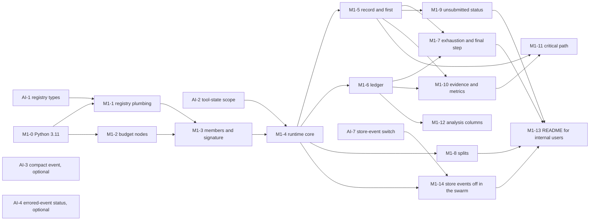
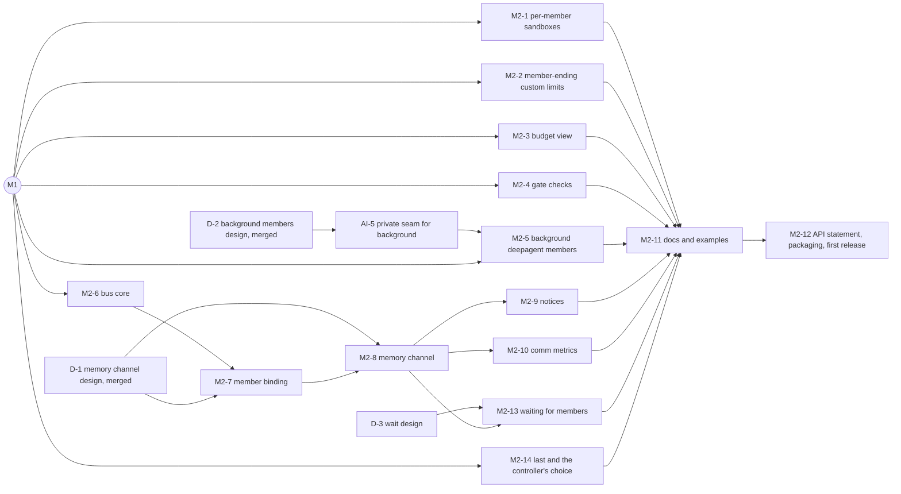

# Inspect Swarm: implementation plan

Status: proposed, 2026-10-13. Issue: none. Author: agent (Claude), reviewed by Codex; see the PR.

## Overview

This is the build plan for inspect_swarm across the merged designs. It is a plan, not a design: each pull request below names the design sections it implements. The few things a pull request needs that no merged design decides (M1's critical-path definition and stuck-in-loops signal, refusing bridged members in a swarm with a bus channel) are Ransom's decisions, recorded under [Decisions](#decisions); the rest waits for the design pull requests in the graph.

There are two milestones (decision: Ransom, 2026-10-13):

- **M1, ready for first internal usage.** A leaderless swarm over a shared sandbox, with full accounting: the `swarm()` API with registered controllers and channels, per-member tool state, a budget cap that stops members in an orderly way, a ledger of what was actually spent, the final answer `first`, with each member's submission status and time recorded, and evidence and metrics in the log. Existing task scorers score it unchanged. Two small inspect_ai pull requests land first, the registry types and the tool-state scope; a third, the store-event switch, must merge on inspect_ai `main` before the runtime enters it, so that spans inside a swarm log no `StoreEvent`s (decision: Ransom, 2026-10-19).
- **M2, ready for external usage.** What an external team needs to port its own agent-swarm experiment and gain from it, measured against Epoch's LeanOpenProblems swarm: a sandbox per member, background deepagent members, a shared-memory channel routed through a monitored bus, budget visibility for members, custom limits that end only the member and gate-check metrics, plus user docs, examples, a statement that the API is experimental and a first PyPI release. The port keeps its own scorer, so M2's only scoring addition is the answer rule: `last` beside `first`, and a controller's choice of the answer (M2-14).

Direct messages between members and scoring beyond `first`, `last` and a controller's choice (the result contract, per-member scores, `baseline()` and the comparisons with epochs) are not needed for that and are future work ([Decisions](#decisions), Ransom, 2026-10-14).

Each milestone is a set of small pull requests. Most are in this repository; four are in inspect_ai, each a separate pull request with its own place in the dependency graph. Neither milestone needs a change in inspect_swe or inspect_sentinel. Everything else in the designs is future work, in any order.

## Why

The designs are separate deep dives, each with its own implementation plan. The milestones are defined by two audiences: internal users first, external users next, with Epoch's swarm as the test of the second (decision: Ransom, 2026-10-13). Building needs one ordered list of pull requests that says which design text each implements, which can be built at the same time, and what is deliberately left for later.

## Goals and non-goals

Goals:

- Define M1 and M2, deciding where each item the deep dives assigned to a milestone lands, with the reason.
- Break each milestone into pull requests that are as independent as possible, each with its scope, files, tests, dependencies and the design sections it implements, and show which can be built in parallel.
- Identify the inspect_ai, inspect_swe and inspect_sentinel pull requests separately.
- List the future work, one line per item.

Non-goals:

- New design. Where a pull request needs a decision no merged design makes, it is an [open question](#open-questions), a decision Ransom made for this plan ([Decisions](#decisions)), or a design pull request in the graph, not something this document settles on its own.
- ORBIT (PR #4, an open draft). Future work only.

## Current state

What the plan starts from, checked on 2026-10-13:

- **No runtime code.** `src/inspect_swarm/` holds only `__init__.py` (exporting `__version__` and nothing else), `_version.py` and `py.typed`; `tests/` holds the scaffold's package test.
- **The merged designs:** [swarm-overview.md](swarm-overview.md), [swarm.md](swarm.md), [swarm-api.md](swarm-api.md), [swarm-communication.md](swarm-communication.md) (with its optional push delivery), [swarm-limits.md](swarm-limits.md), [swarm-scoring.md](swarm-scoring.md), [swarm-lean-open-problems.md](swarm-lean-open-problems.md) and [swarm-sandbox-isolation.md](swarm-sandbox-isolation.md).
- **The inspect_ai prerequisites have not landed.** inspect_ai `main`'s `RegistryType` has no `swarm_controller` or `swarm_channel` (`src/inspect_ai/_util/registry.py`), and `inspect_ai.util` has no `tool_state_scope`. On 2026-10-19, `track_store_changes()` read no switch (`src/inspect_ai/log/_transcript.py:1104-1111`, at `5a2bafe9`). This repository's lockfile installs inspect_ai `0.3.278.dev1+gfccfb298e`; the latest inspect_ai release is 0.3.279 (2026-10-12).
- **inspect_sentinel's dispatcher has reached inspect_ai `main`.** `src/inspect_ai/_sentinel/` (with `_dispatch.py`) is on `main`, with commits through 2026-10-12 (#5811, "sentinel monitors can watch every agent's model calls"). Its tool stages still do not run for bridged agents: `warn_sentinel_bridged()` (`src/inspect_ai/_sentinel/_context.py:57-64`, at `81c1668d3`) warns that bridged agents' tool calls are not monitored, only their model calls (inspect_ai#5759). So the bus's `policy=` hook is still needed for bridged sends ([Decisions](#decisions), item 5).
- **The scaffold is still on Python 3.10.** `pyproject.toml` (`requires-python = ">=3.10"`, pyright `pythonVersion = "3.10"`), `AGENTS.md`, `CONTRIBUTING.md` and the CI matrix in `.github/workflows/build.yaml` (`["3.10", "3.14"]`) predate the 3.11 decision (decision: Ransom, 2026-10-07; [swarm.md Compatibility](swarm.md#compatibility-and-migration)).
- **Releases are off.** `.github/workflows/release.yaml` has only `workflow_dispatch`; its comment says to restore the `push` trigger to cut 0.1.0. The `inspect-ai` dependency was a PyPI version floor (`>=0.3.281`, #25, 2026-10-16) until M1-4 (#27) moved it back to inspect_ai's git `main` for AI-2 (inspect_ai#5861). It stayed that git reference, `inspect-ai @ git+https://github.com/UKGovernmentBEIS/inspect_ai@main`, which M1-14 (#46) locked in `uv.lock` at AI-7's merge, until 2026-10-22, when it moved back to a floor, `inspect-ai>=0.3.283`, ahead of M2-12: 0.3.283 is the first release with all of AI-1, AI-2, AI-5 and AI-7 (decision: Ransom, 2026-10-22). inspect_swarm never waits for an inspect_ai PyPI release: between releases, a change that needs an unreleased inspect_ai feature may use the git reference to inspect_ai `main` again; only an inspect_swarm PyPI release (M2-12) needs a released `inspect-ai>=X` floor (decision: Ransom, 2026-10-20).
- **Sibling packages' layout for docs and examples.** inspect_sentinel and inspect_flow keep a Quarto site in `docs/` (`_quarto.yml`); inspect_sentinel keeps runnable `examples/`. This repository's `pyproject.toml` already excludes `docs/` from the wheel and from ruff.

## Milestones

### M1: ready for first internal usage

M1 is a leaderless filesystem swarm with full accounting ([swarm.md Implementation plan](swarm.md#implementation-plan)). It contains:

- the `swarm()` API skeleton with `@swarm_controller`, `@swarm_channel`, members as built agents or `member()` records, copies built from an `@agent` factory and its arguments for each member in each sample, and no agent object running twice in a sample ([swarm-api.md, the member contract](swarm-api.md#the-member-contract)), name resolution and faithful logging, and the built-ins `leaderless` and `filesystem` ([swarm-api.md](swarm-api.md#implementation-plan), steps 2 to 4);
- the shared-sandbox default with its filesystem prompt convention, and per-member tool state through the tool-state scope ([swarm.md Members](swarm.md#members), [Sandbox topology](swarm.md#sandbox-topology));
- members whose work stays inside their invocation (`react()`, synchronous `deepagent()`, bridged agents); background members rejected, and ACP agents refused when built;
- the budget: swarm nodes, `Budget` with derived caps, member limits, the soft stop with grace, recovery from the swarm's own cap only, the final step and the provisional answer, the ledger, and splits ([swarm-limits.md](swarm-limits.md#implementation-plan), all five steps);
- the final answer `first`, the provisional answer and the per-member result record ([swarm-scoring.md Part 1](swarm-scoring.md#implementation-plan-for-m1)); this is how the brief's "final-answer modes, the result contract" is read (decision: Ransom, 2026-10-14);
- `InfoEvent` evidence, a named timeline per member, a recorded stop reason, metrics, harness-validity checks, and a simple critical path: the steps to the answer and the longest member's step count (decision: Ransom, 2026-10-14; [swarm.md Observer](swarm.md#observer-evidence-accounting-and-metrics));
- `SwarmColumns`, columns for Inspect's `samples_df()` with each sample's realized cost and ledger data;
- three small items from [swarm-lean-open-problems.md](swarm-lean-open-problems.md#recommended-changes-to-our-designs): the `unsubmitted` status, the rejection of an integer `background`, and documentation that the default `memory()` is private to each member ([table](#where-the-deep-dives-milestone-items-land));
- the two inspect_ai pull requests that land first: the registry types (decision: Ransom, 2026-10-08) and the tool-state scope (decision: Ransom, 2026-10-09);
- no `StoreEvent`s inside the swarm: the inspect_ai store-event switch (AI-7) and the runtime entering it (M1-14) (decision: Ransom, 2026-10-19; [swarm.md Store events](swarm.md#observer-evidence-accounting-and-metrics)).

Done means: an internal user can run a leaderless swarm of `react()`, synchronous `deepagent()` or bridged members on an existing task, sweep member count and budget as task parameters, and compare arms on the ledger's realized cost, with the task's own scorers unchanged.

M1 is complete: every M1 pull request has merged, the last (M1-13, #51) on 2026-10-20.

### M2: ready for external usage

M2's test is Epoch's LeanOpenProblems swarm: an external team could port that experiment to inspect_swarm and gain from doing so ([swarm-lean-open-problems.md](swarm-lean-open-problems.md)). Its analysis says what the port needs and what the port gains ([Could inspect_swarm express their experiment?](swarm-lean-open-problems.md#could-inspect_swarm-express-their-experiment), [What they would gain and lose](swarm-lean-open-problems.md#what-they-would-gain-and-lose)). M2 contains:

- **What the port needs:** per-member sandboxes (Recommendation 1), an agent-raised custom limit that ends only the member (Recommendation 2), and background deepagent members, which need a private inspect_ai seam for where `background()` starts work and an owner per member in inspect_swarm (Recommendation 3; [swarm-background-members.md](swarm-background-members.md)). Without the first two the port cannot express the experiment. Without the third a port must run `deepagent()` synchronously, so each subagent call blocks its member, which changes the experiment and makes its results not comparable to Epoch's. With them it runs with its scorer unchanged ([With recommendations 1 and 2 it can](swarm-lean-open-problems.md#could-inspect_swarm-express-their-experiment)).
- **What the port gains:** members that can see the budget that will stop them (Recommendation 4), gate checks as metrics (Recommendation 5), and a shared-memory channel through the bus (Recommendation 7).
- **Waiting for other members:** a wait owned by the bus, `swarm_wait`, which the shared-memory channel's writes and members' ends wake, so members working together need not poll ([swarm-wait.md](swarm-wait.md), D-3; decision: Ransom, 2026-10-21, [Decisions](#decisions), item 13).
- **The bus**, because the shared-memory channel runs through it: `deliver()`, storm controls, evidence, member binding, notices and communication metrics ([swarm-communication.md](swarm-communication.md#implementation-plan), steps 1, 2, 4 and 5), with a construction-time refusal of bridged members in a swarm that has a bus channel (M2-6).
- **What any external release needs:** user docs, examples (among them the `until_proved` controller of Recommendation 6), a statement that everything is experimental ([Decisions](#decisions), item 6), packaging, the Python floor, and a first PyPI release that depends on released inspect_ai.

Not in M2 (decisions: Ransom, 2026-10-14; [Decisions](#decisions)):

- The `messages` channel (direct messages) and bus channel tools for bridged members. Epoch's swarm uses neither, and the port gains nothing from them that the shared-memory channel does not give it.
- Scoring beyond `first`, `last` and a controller's choice (M2-14): swarm-scoring.md Part 2's result contract and record additions, `member_scores`, `baseline()` and the analysis helper, and per-member sandboxes in the scoring contract (Recommendation 8). The port runs with its own scorer, and the Lean analysis lists these as optional gains after M2 ([What they would gain and lose](swarm-lean-open-problems.md#what-they-would-gain-and-lose)). Under per-member sandboxes in M2, the task's scorers run after the swarm, where `sandbox()` is `default`; a scorer that grades members' artifacts names each member's sandbox itself, as Epoch's end-of-sample check does today, and the record's `sandbox` field says which member used which (M2-1).

Done means: Epoch's port as sketched in [A port, sketch](swarm-lean-open-problems.md#a-port-sketch) runs on inspect_swarm with background deepagent members, per-member sandboxes and a bus-routed board, from a PyPI release, with docs that describe it.

### Where the deep dives' milestone items land

Each item a deep dive assigns to a milestone, with the milestone it is in and why:

| Item | Source | Milestone | Why |
|---|---|---|---|
| Swarm nodes, `Budget`, member wrapper, stopping, exhaustion, ledger | [swarm-limits.md](swarm-limits.md#implementation-plan) steps 1–4 | M1 | The cap and the ledger are what M1's comparisons rest on |
| Budget splits and the sweep example | swarm-limits.md step 5 | M1 | Budget split is one of the library's sweepable axes ([swarm.md Goals](swarm.md#goals)); small, and a leaf of the graph |
| Optional inspect_ai observability PRs (a `Model.compact()` event; a status code on errored model events) | swarm-limits.md [open question 3](swarm-limits.md#open-questions) | Optional, alongside M1, not blocking | They relax the ledger's completeness rules; the ledger works without them |
| Record and `first` | [swarm-scoring.md](swarm-scoring.md#implementation-plan-for-m1) | M1 | M1's answer and the record scorers read |
| Per-member sandboxes, `member(sandbox=, visible_sandboxes=)` | [Lean Rec. 1](swarm-lean-open-problems.md#1-m2-per-member-sandboxes-as-an-opt-in-member-field) | M2 | Needed by the external port; internal first use runs on the shared default (decision: Ransom, 2026-10-07) |
| Agent-raised custom limit ends only the member | [Lean Rec. 2](swarm-lean-open-problems.md#2-m2-an-agent-raised-custom-limit-ends-only-the-member) | M2 | Needed by the external port; until then such an error ends the sample loudly, as it does for any agent today, rather than producing a wrong result |
| Reject integer `background` as well as `True` | [Lean Rec. 3](swarm-lean-open-problems.md#3-m2-background-deepagent-members), M1 part | M1 | Without it `deepagent(background=64)` slips past the rejection and breaks the drain guarantee silently |
| Background deepagent members (a private inspect_ai seam for `background()`, an owner per member in inspect_swarm) | Lean Rec. 3; [swarm.md Members](swarm.md#members); [swarm-background-members.md](swarm-background-members.md) | M2 | Both of Epoch's configs use them; without them a port must run `deepagent()` synchronously, so each subagent call blocks its member, which changes the experiment and makes its results not comparable to Epoch's |
| Budget visible to members | [Lean Rec. 4](swarm-lean-open-problems.md#4-m2-members-can-see-the-budget-that-will-stop-them) | M2 | Members pacing themselves is the external port's need; first internal use needs the cap, not the view |
| Gate checks as metrics | [Lean Rec. 5](swarm-lean-open-problems.md#5-m2-gate-checks-as-metrics) | M2 | The outcome gated tasks like Epoch's care about; not needed to run or compare a first internal swarm |
| Critical-path steps for leaderless swarms | [swarm.md Observer](swarm.md#observer-evidence-accounting-and-metrics), Metrics | M1, the simple definition; the dependency-linked one Future | Decision: Ransom, 2026-10-14. M1's only channel, the filesystem, is observed but not attributed, so a chain linked by reads of another member's writes has no cross-member edges in M1 |
| `unsubmitted` status for `react()`'s non-submit returns | [Lean Rec. 6](swarm-lean-open-problems.md#6-m1-tighten-submitted-m2-document-stopping-on-the-first-proof), first part | M1 | Without it `first` can select a member that returned after three refusals or a context overflow: a wrong answer for any internal `react()` swarm |
| The `until_proved` example controller | Lean Rec. 6, second part | M2 docs | An example for verifier-gated external tasks |
| Documentation that the default `memory()` is per member | [Lean Rec. 7](swarm-lean-open-problems.md#7-m2-a-shared-memory-channel-through-the-bus), M1 part | M1 | The scope makes a hand-rolled shared board fail silently; internal users porting hand-rolled swarms hit it first |
| Shared-memory channel through the bus | Lean Rec. 7 | M2 | The port's channel, with sender binding, fencing, notices and evidence |
| Per-member sandboxes in the scoring contract | [Lean Rec. 8](swarm-lean-open-problems.md#8-after-m2-per-member-sandboxes-in-the-scoring-contract) | Future | Decision: Ransom, 2026-10-14. The port runs with its own scorer; Rec. 8 builds on the result contract, which is future work |
| Result contract, `member_scores`, `baseline()`, analysis helper | [swarm-scoring.md Part 2](swarm-scoring.md#implementation-plan-after-m2) steps 1, 4, 5 | Future | Decision: Ransom, 2026-10-14. Optional gains for the port, not needs; M2's "Done means" asks for none of them |
| Bus core, binding, notices, communication metrics | [swarm-communication.md](swarm-communication.md#implementation-plan) steps 1, 2, 4, 5 | M2 | The shared-memory channel needs them |
| Waiting for other members (`swarm_wait`) | [swarm-wait.md](swarm-wait.md) | M2 | Decision: Ransom, 2026-10-21. Members working together often wait on each other; without a wait they poll, which inflates steps, cost and the critical path |
| The bus hook (`policy=`) | [swarm-communication.md Monitoring](swarm-communication.md#monitoring-sentinel-first-the-bus-hook-for-the-rest) | Future | Decision: Ransom, 2026-10-19. Every M2 record is a native tool call that sentinel sees; the hook is for bridged bus tools and internal records |
| The `messages` channel; bus tools for bridged members | swarm-communication.md steps 3, 6 | Future | Decision: Ransom, 2026-10-14. Not needed by the external port; bridged members are refused in a swarm with a bus channel (M2-6) |

Everything else the deep dives place after M2 or later is future work.

## M1 pull requests

IDs: `AI-n` are inspect_ai pull requests (opened on the Meridian fork and promoted to `UKGovernmentBEIS/inspect_ai` as usual); `M1-n` are inspect_swarm. inspect_swarm never waits for an inspect_ai PyPI release: an inspect_swarm pull request that depends on an inspect_ai one waits for it to merge on inspect_ai `main`, depends on inspect_ai `main` through a git reference in `pyproject.toml` when no release has it yet, and updates `uv.lock` with `uv lock --upgrade-package inspect-ai` in its own diff. M1 and M2-5 depended on inspect_ai `main` this way; the dependency moved back to a released floor on 2026-10-22 ([Current state](#current-state)). Only an inspect_swarm PyPI release (M2-12) needs a released inspect_ai floor (decision: Ransom, 2026-10-20). inspect_ai's changelog is written by Release Please from the pull request title, so no inspect_ai pull request edits `CHANGELOG.md`.

### Graph

What can be built in parallel, in waves (each wave starts when its dependencies merge):

1. AI-1, AI-2, AI-7 and M1-0, all independent. The optional AI-3 and AI-4 can go at any point.
2. M1-1 (after AI-1 and M1-0) and M1-2 (after M1-0).
3. M1-3.
4. M1-4 (needs AI-2).
5. M1-5, M1-6 and M1-8, in parallel; M1-14 once AI-7 is merged on inspect_ai `main`.
6. M1-7, M1-9, M1-10 and M1-12, in parallel.
7. M1-11 and M1-13.

The critical path is AI-1 → M1-1 → M1-3 → M1-4 → M1-5 → M1-7 → M1-13, with AI-2 needed by M1-4 and AI-7 by M1-14, which M1-13 waits for. Starting AI-2 and AI-7 in wave 1 keeps them off the critical path, as long as AI-7 merges on inspect_ai `main` in time for M1-14 to merge before M1-7 does.

### inspect_ai

**AI-1. Registry types `swarm_controller` and `swarm_channel`.** Done: merged on 2026-10-14 as inspect_ai#5860, first released in 0.3.281. Adds the two values to `RegistryType`, with a test that registers, looks up and round-trips one object of each (`is_registry_dict()`), as inspect_ai#4359 did for `validation_predicate`.
- Files: `src/inspect_ai/_util/registry.py`, `tests/util/test_registry.py`.
- Depends on: nothing.
- Implements: [swarm-api.md The registry](swarm-api.md#the-registry) and its implementation plan step 1 (decision: Ransom, 2026-10-08; prefix 2026-10-09).

**AI-2. The tool-state scope.** Done: merged on 2026-10-16 as inspect_ai#5861, first released in 0.3.282; [swarm.md Members](swarm.md#members) describes it as merged. `tool_state_scope()`, `tool_state_instance()` and `private_tool_instance()`, exported from `inspect_ai.util`; `memory()`, `bash_session()`, `web_browser()` (refusing its legacy fallback inside a scope) and the skill tool resolve their default instance through it; deepagent's child skill instance becomes `private_tool_instance(sa.name)`.
- Files: `src/inspect_ai/util/_tool_state.py`, `src/inspect_ai/util/__init__.py`, `src/inspect_ai/tool/_tools/_memory.py`, `_bash_session.py`, `_web_browser/_web_browser.py`, `_skill/tool.py`, `_skill/install.py` (the shared install, as merged), `src/inspect_ai/agent/_deepagent/agent_tool.py`.
- Tests: `tests/util/test_tool_state.py`, `tests/tools/test_memory.py`, `tests/tools/test_skill.py`, stubbed-RPC cases for `bash_session()` and `web_browser()`, as [swarm-api.md Testing](swarm-api.md#testing) lists. No Docker.
- Depends on: nothing.
- Implements: [swarm.md Members](swarm.md#members) ("Per-member tool state") and [open question 2](swarm.md#open-questions) (decision: Ransom, 2026-10-09); swarm-api.md implementation plan step 1's second pull request.

**AI-3 (optional). An event from `Model.compact()` at invocation.** Lets the ledger judge native compaction per call instead of treating every run in a process that has loaded a native-compaction provider as a lower bound.
- Files and tests: inspect_ai's model and event modules; to be scoped when proposed.
- Depends on: nothing. Nothing in M1 depends on it.
- Implements: [swarm-limits.md open question 3](swarm-limits.md#open-questions) and its "Native compaction" item under Not this design. The question is undecided; this plan carries it as optional.

**AI-4 (optional). A status code on errored model events.** Lets the ledger count a verified pre-inference rejection (an HTTP 429) as zero spend instead of unknown.
- Depends on: nothing. Nothing in M1 depends on it.
- Implements: the same open question; undecided.

**AI-7. The store-event switch.** A context-scoped switch, a `ContextVar` with a context manager to enter it, that `track_store_changes()` and the checkpointing span (`SpanRotationScope`, when it snapshots the store for a span) read when a span is entered: spans entered inside it take no snapshots and log no `StoreEvent`, and spans entered before it diff as now. Done: merged on 2026-10-20 as UKGovernmentBEIS/inspect_ai#5960, first released in 0.3.283. The switch is `suspend_store_events()`, private (not exported from `inspect_ai.util`): inspect_swarm imports it from `inspect_ai.util._store`. It changes nothing outside the switch, and leaves the raising-span path and meridianlabs-ai/inspect_ai#589's general fix to their own pull requests ([swarm.md Not this design](swarm.md#not-this-design)).
- Files: `src/inspect_ai/log/_transcript.py`, `src/inspect_ai/util/_span.py`, `src/inspect_ai/util/_store.py`.
- Tests: in inspect_ai's own suite: a span entered inside the switch logs no `StoreEvent`, nor do spans nested in it or tasks started inside it; a span entered before it logs the net change; the checkpointing span inside it logs none. No Docker.
- Depends on: nothing. M1-14 needs it merged on inspect_ai `main`.
- Implements: [swarm.md Store events](swarm.md#observer-evidence-accounting-and-metrics) (decision: Ransom, 2026-10-19).

### inspect_swarm

**M1-0. Python 3.11 floor.** Done: merged on 2026-10-14 as #16. A `chore:` pull request that moves the scaffold from 3.10 to 3.11, so later pull requests may use `ExceptionGroup` and `except*` natively.
- Files: `pyproject.toml` (`requires-python`, pyright `pythonVersion`, the "Matches inspect-ai's floor" comment), `uv.lock`, `AGENTS.md`, `CONTRIBUTING.md`, `.github/workflows/build.yaml` (matrix `["3.11", "3.14"]`).
- Tests: CI on the new matrix.
- Depends on: nothing. Every other inspect_swarm pull request is based on it, because pyright's `pythonVersion` and the CI matrix decide which syntax passes.
- Implements: [swarm.md Compatibility](swarm.md#compatibility-and-migration) ("These move to 3.11 in a separate scaffold PR before M1") (decision: Ransom, 2026-10-07).

**M1-1. Registry plumbing.** Done: merged on 2026-10-14 as #19. The `@swarm_controller` and `@swarm_channel` decorators, `Controller`, `Channel` (M1's `instructions()` only), `MemberInfo`, `resolve()` and the `inspect_ai` entry point.
- Files: `src/inspect_swarm/_controller/_controller.py`, `src/inspect_swarm/_channel/_channel.py`, `src/inspect_swarm/_registry.py`, `src/inspect_swarm/_entrypoint.py`, `pyproject.toml` (`[project.entry-points.inspect_ai]`), `uv.lock`.
- Tests: `tests/test_registry.py`.
- Depends on: M1-0, AI-1.
- Implements: [swarm-api.md](swarm-api.md#implementation-plan) step 2; [Resolving names](swarm-api.md#resolving-names).

**M1-2. Swarm nodes and the budget parameter.** Done: merged on 2026-10-14 as #17. `Budget` as a frozen pydantic model with validation and cap derivation, the swarm node classes and cost pairs (ownership, messages, per-call pricing, the bridged branch), bridged detection, and the tests that pin the inspect_ai behaviour the nodes rely on.
- Files: `src/inspect_swarm/_budget.py`.
- Tests: `tests/test_budget.py` (pinned behaviour, validation, derivation, nodes).
- Depends on: M1-0. Independent of M1-1.
- Implements: [swarm-limits.md](swarm-limits.md#implementation-plan) step 1; [The node tree](swarm-limits.md#the-node-tree), [The budget parameter](swarm-limits.md#the-budget-parameter), [Swarm nodes](swarm-limits.md#swarm-nodes).

**M1-3. Members and the `swarm()` signature.** Done: merged on 2026-10-15 as #21. `Member` and `member()` with the built-agent form (`agent`) and the factory form (`factory`, `args`), their serialisers (a built agent as Inspect's agent registry dict; a factory as its registry name, `args` as `@agent` logs an agent's params), the private `build_member()` the runtime calls, count expansion and names, with repeated default names numbered in roster order; the construction checks, which refuse a built agent with `count > 1` or `args` (the message showing the factory form), an unregistered callable and `args` that do not bind to the factory's signature, all without calling the factory; `swarm()`'s arguments, validation and resolution, including bare built agents in `members=`, the refusal of bare factories, the identity check that no agent object is in two members, and logged member dicts in both forms; the exports. The background rejection reads a built deepagent's params or a factory's `args`, and catches an integer `background` as well as `True`. `member()`'s docstring states the member contract: no agent object runs twice in a sample, copies need the factory form, which builds each member's agent in each sample, objects given to agents (a factory's `args`, a tool object two built agents hold) are shared by every member and sample they reach, and a stateful custom tool belongs inside a member builder; and the tool-state contract, including that the default `memory()` instance is private to each member and a board shared on purpose is `memory(instance="...")`.
- Files: `src/inspect_swarm/_member.py`, `src/inspect_swarm/_swarm.py`, `src/inspect_swarm/__init__.py`.
- Tests: `tests/test_member.py` (including the refusals, bare factories, the identity check, default-name numbering, `background=64` in both forms and validating the logged dict in both forms), `tests/test_api_log.py` (the logged forms for a bare agent, a list of agents, a single record and a mixed list, with package namespaces kept; replay rebuilding built agents and resolving factories without building them; and `eval_set` identity for two arms that differ in a built agent's params or a factory's `args`).
- Depends on: M1-1, M1-2 (the signature takes a `Budget`).
- Implements: [swarm-api.md](swarm-api.md#implementation-plan) step 3, [Members](swarm-api.md#members), [Logging and replay](swarm-api.md#logging-and-replay); [Lean Rec. 3](swarm-lean-open-problems.md#3-m2-background-deepagent-members)'s M1 part; [Lean Rec. 7](swarm-lean-open-problems.md#7-m2-a-shared-memory-channel-through-the-bus)'s M1 documentation part.

**M1-4. Runtime core: the controller surface, members and stopping.** Done: merged on 2026-10-16 as #27, against merged AI-2 (inspect_ai#5861, through inspect_ai's git `main`), whose differences from the proposed scope ([swarm.md Members](swarm.md#members)) the designs now follow. Beyond this entry it refuses explicit member names that cannot name a tool-state scope (empty, or containing `/` or `#`; a default from a registry name is not checked until the member starts), refuses `Budget.split` shares until M1-8, adds `member(bridged=)` and the cost-data check ([swarm-limits.md Swarm nodes](swarm-limits.md#swarm-nodes)), and writes the stop record M1-5 replaces. The largest M1 pull request, because the two deep dives place these steps together: `SwarmControl`, `MemberHandle`, `MemberEnded`, `events()`, `start()` and the preamble; the member wrapper with its lever, re-created member limits and leaf-by-leaf error classification, each member's task entered in its tool-state scope and a factory-form member's agent built there by `build_member()` (a factory error makes the member `errored`; an ACP agent is refused with `TypeError`); the runtime lever; `stop()` with step 0, soft stop, grace and hard stop; the time-cap timer; member statuses and stop reasons; the built-ins `leaderless` and `filesystem`.
- Files: `src/inspect_swarm/_controller/_control.py`, `src/inspect_swarm/_controller/leaderless.py`, `src/inspect_swarm/_channel/filesystem.py`, `src/inspect_swarm/_member.py`, `src/inspect_swarm/_swarm.py`, `uv.lock`.
- Tests: `tests/test_controller.py` (including one agent per factory-form member per sample: six builds for `count=3` over two concurrent samples, the build inside the member's scope, the factory error and the ACP refusal), `tests/test_channel.py`, `tests/test_swarm_limits.py` (members and stopping), `tests/test_scoring_loop.py` (its M1 case), the per-member tool-state cases of swarm.md's runtime tests (the deepagent skill, `bash_session()` and `web_browser()` cases in `tests/test_tool_state.py`). Filesystem-channel tests use the local sandbox, or Docker marked slow and skipped in CI without it.
- Depends on: M1-3, AI-2.
- Implements: [swarm-api.md](swarm-api.md#implementation-plan) step 4, [Controller and runtime](swarm-api.md#controller-and-runtime), [Controllers](swarm-api.md#controllers), [Channels](swarm-api.md#channels); [swarm-limits.md](swarm-limits.md#implementation-plan) step 2, [Stopping](swarm-limits.md#stopping); [swarm.md Members](swarm.md#members) and [Sandbox topology](swarm.md#sandbox-topology).

**M1-5. The record and `first`.** Done: merged on 2026-10-19 as #31. The record keeps no member outputs or models (decision: Ransom, 2026-10-19), and the `final` event replaced M1-4's `stopped` event. `MemberResult`, `FinalRecord` and `SwarmResultRecord` in the store; `first`, the provisional answer, finalisation and the returned `AgentState`; the `member_result` and `final` evidence events; the wrapper keeps its `AgentState` reference. M1-4 writes one `InfoEvent` (`source="inspect_swarm"`, `version: 1`, `type: "swarm"`, `kind: "stopped"`, with the stop `reason` and each member's `state` and `status`) when the stop procedure ends (decision: Ransom, 2026-10-16: keep it until M1-5 replaces it). M1-5's `final` evidence event supersedes it: M1-5 replaces it or folds its fields into `final`, and never writes both.
- Files: `src/inspect_swarm/_record.py`, `src/inspect_swarm/_final.py`, `src/inspect_swarm/_evidence.py`, `src/inspect_swarm/_swarm.py`, `src/inspect_swarm/_controller/_control.py`.
- Tests: `tests/test_final.py`, `tests/test_task_scorers.py` (with the local sandbox for the files case).
- Depends on: M1-4.
- Implements: [swarm-scoring.md Part 1](swarm-scoring.md#implementation-plan-for-m1): [The final answer: `first`](swarm-scoring.md#the-final-answer-first), [What the swarm records](swarm-scoring.md#what-the-swarm-records).

**M1-6. The ledger.** Done: merged on 2026-10-19 as #32, in a new `_ledger.py`, with the store key `inspect_swarm:ledger`; it created the final meter, which M1-7 entered. `MemberLedger` and `SwarmLedger`, event counting, reconciliation and claims, written as an `InfoEvent` and a store entry.
- Files: `src/inspect_swarm/_budget.py` (or `_ledger.py` if it grows), `src/inspect_swarm/_evidence.py`.
- Tests: the ledger cases of `tests/test_budget.py`.
- Depends on: M1-4. Whichever of M1-5 and M1-6 merges first creates `_evidence.py`.
- Implements: [swarm-limits.md](swarm-limits.md#implementation-plan) step 4, [The ledger](swarm-limits.md#the-ledger); [swarm.md Accounting](swarm.md#observer-evidence-accounting-and-metrics).

**M1-7. Exhaustion and the final step.** Done: merged on 2026-10-19 as #38. It also gave the ledger an `ended_by` field, what from outside ended the swarm, beside `stop_reason` (decision: Ransom, 2026-10-19), and the runtime now strips the swarm's own leaves from foreign errors as the wrapper does. M1-4 already supplies recovery from the swarm's own caps (the cap node begins the stop and the member wrapper records `swarm_cap`, `src/inspect_swarm/_member.py`, `run_member()`) and propagation with the swarm's own errors removed from mixed groups (`classify_errors()`, in the wrapper and for the controller's `run` in `src/inspect_swarm/_controller/_control.py`). What is left for M1-7: the synchronous `finally` that writes the ledger and the output on every exit path, including cancellation from outside; the guarantee that the ledger and the provisional answer survive a sample limit; and the final meter around finalisation and the provisional answer.
- Files: `src/inspect_swarm/_controller/_control.py`, `src/inspect_swarm/_ledger.py`, `src/inspect_swarm/_member.py`.
- Tests: the exhaustion cases of `tests/test_swarm_limits.py`, including that a sample time limit leaves the ledger and the provisional answer written.
- Depends on: M1-5 (the finalisation it wraps) and M1-6 (the ledger its tests check). This runs swarm-limits.md's steps 3 and 4 in the other order, so that step 3's test of the ledger surviving a sample limit lands with it.
- Implements: [swarm-limits.md](swarm-limits.md#implementation-plan) step 3, [Exhaustion and errors](swarm-limits.md#exhaustion-and-errors), [The final step and the reserve](swarm-limits.md#the-final-step-and-the-reserve).

**M1-8. Splits and the sweep example.** Done: merged on 2026-10-19 as #30. The sweep example is in `docs/budget.qmd`, the first user-docs page, not in `README.md`; a member stopped by its share ends `share`. Share nodes and validation for `split` (`"pool"`, `"equal"`, weights), and a task example in `README.md` showing the sweeps.
- Files: `src/inspect_swarm/_budget.py`, `README.md`.
- Tests: the split cases of `tests/test_budget.py` and `tests/test_swarm_limits.py`.
- Depends on: M1-4.
- Implements: [swarm-limits.md](swarm-limits.md#implementation-plan) step 5, [Splits](swarm-limits.md#splits), [Budget splits as a sweep axis](swarm-limits.md#budget-splits-as-a-sweep-axis).

**M1-9. The `unsubmitted` status.** Done: merged on 2026-10-20 as #39. `_final.py` needed no change, since `first` already selects only `submitted` members; `MemberHandle.status`'s docstring in `_controller/_control.py` lists the new status. The member wrapper gives `unsubmitted` when a returned state's `output.stop_reason` is `content_filter` or `model_length`, and `submitted` otherwise; `first` never selects an `unsubmitted` member; `member()` documents that other agents keep the rule that a normal return is a submission.
- Files: `src/inspect_swarm/_member.py`, `src/inspect_swarm/_final.py`.
- Tests: the Rec. 6 cases of [Lean Testing](swarm-lean-open-problems.md#testing) that need no custom controller, in `tests/test_final.py` and `tests/test_swarm_limits.py`.
- Depends on: M1-5.
- Implements: [Lean Rec. 6](swarm-lean-open-problems.md#6-m1-tighten-submitted-m2-document-stopping-on-the-first-proof), first part.

**M1-10. Evidence, timelines, metrics and harness-validity checks.** Done: merged on 2026-10-20 as #41. A named timeline per member (`transcript().add_timeline()`), the metrics swarm.md lists that M1 can measure (per-member and total tokens and cost from the ledger, the swarm's wall clock, and each member's running time from its start to its end), and harness-validity checks reported apart from the task score: a member that never acted, and members stuck in loops, reported as a signal rather than a verdict (decision: Ransom, 2026-10-14; [Decisions](#decisions), item 9). For the second, each member's metrics carry `longest_identical_tool_run`, the longest run of consecutive tool calls in the member's spans with the same function and the same arguments (compared as canonical JSON). No threshold is fixed until there is data; analysis applies one. A bridged member's tool calls have no `ToolEvent`s ([swarm-communication.md The filesystem channel](swarm-communication.md#the-filesystem-channel)), so its value is `None`, not 0. Per-member idle time and per-member waiting time are not in M1 (decision: Ransom, 2026-10-20; [Decisions](#decisions), item 12).
- Where it is written: the metrics are written like the ledger (M1-7), when the swarm ends, in the synchronous `finally` of `SwarmRun.run()`, as an `InfoEvent` with `type: "metrics"` and the store entry `inspect_swarm:metrics`, not in sample metadata (decision: Ransom, 2026-10-20, accepting the code over this entry's first draft). The member timelines are added, empty, when `SwarmRun.run()` starts, so a member name already taken by a timeline in the sample is refused before any member runs, and filled in the same `finally`. `swarm()` refuses members named `init`, `solvers` or `scorers` when it is built, because Inspect's `timeline_build()` reads spans with those names as the sample's phases (decision: Ransom, 2026-10-20).
- Files: `src/inspect_swarm/_metrics.py`, `src/inspect_swarm/_evidence.py`, `src/inspect_swarm/_ledger.py` (the event log also keeps tool events; span placement is shared by the ledger, the metrics and the timelines), `src/inspect_swarm/_controller/_control.py`, `src/inspect_swarm/_swarm.py` (the timeline-name rule in the docstring and the phase-name refusal).
- Tests: `tests/test_metrics.py`, on mockllm runs: tokens and cost from the ledger; running time; a member that never acted; a scripted member repeating one call three times, then changing it, reports a run of 3, and the same function with different arguments does not extend a run; `None` for a bridged member; timelines from a plain and from a bounded transcript that has evicted members' events; a timeline name already taken, before the swarm or while it runs; and a member named `init`, `solvers` or `scorers`, refused at construction.
- Depends on: M1-5, M1-6.
- Implements: [swarm.md Observer](swarm.md#observer-evidence-accounting-and-metrics) ("Metrics", "Member views", the harness-validity bullet of "Analysis").

**M1-11. Critical path for leaderless swarms, the simple definition** (decision: Ransom, 2026-10-14). Done: merged on 2026-10-20 as #43. The definition is a comment on the fields in the private `_metrics.py`, not a docstring; `_controller/_control.py` passes the record's answer to the metrics; and when the swarm ends before finalisation, `steps_to_answer` counts the provisional answer's member (decision: Ransom, 2026-10-20). Two per-sample metrics: `steps_to_answer`, the selected member's completed model calls through its end, including any background drain (absent when there is no answer), and `longest_member_steps`, the largest step count of any member. A step is one completed model call in the member's spans, cache replays included, from the member's ledger line (`calls.calls + calls.cache_replays`, M1-6). Under `first` the selected member ends at its submission, or after its background drain (M2-5; [swarm-background-members.md](swarm-background-members.md#statuses-ended-and-the-record)), so its steps to the answer are all its steps, drain included. Calls a member makes concurrently (parallel subagent tool calls) count one each, so both numbers bound the sequential depth from above; the metric's docstring says so.
- Why this definition: the dependency-linked one swarm.md suggests (the longest chain of member steps linked by reads of another member's writes) needs attributed cross-member reads and writes. M1's only channel, the filesystem, is observed but not attributed, so in M1 that graph has no cross-member edges and reduces to these per-member chains. The linked definition is later work over the bus's evidence ([Future work](#future-work)), and swarm.md's caution stands: latency curves are not interpreted until it exists.
- Files: `src/inspect_swarm/_metrics.py`. Tests: `tests/test_metrics.py`, on mockllm runs with scripted members of known step counts, including a run with no submission.
- Depends on: M1-5 (the selected member), M1-10 (the metrics module and the ledger lines it reads). No separate design.
- Implements: swarm.md Observer, "critical-path steps" ("Settling it is part of M1's metrics work").

**M1-12. Analysis columns.** Done: merged on 2026-10-20 as #40. It also made the ledger's `version` a `Literal[1]` and added pandas and pyarrow to the `dev` dependency group for its tests. `SwarmColumns`, a list of `SampleColumn`s for Inspect's `samples_df()`, gives each sample's realized cost and what the swarm's ledger says about it (roster size, caps, `resumed`, completeness and the call counts that make a cost a lower bound), so `samples_df(logs, columns=SampleSummary + SwarmColumns)` has scores and swarm cost in one dataframe. Comparing arms and fitting λ (Ord's method) over agent count × per-agent budget are the user's own dataframe work over it: helpers that deal with swarm-specific data belong in inspect_swarm, generic statistics and aggregation do not (decision: Ransom, 2026-10-20).
- Files: `src/inspect_swarm/analysis/__init__.py`, `src/inspect_swarm/analysis/_columns.py`.
- Tests: `tests/analysis/`, through `samples_df()` on written logs with known answers.
- Depends on: M1-6 (the ledger's format).
- Implements: [swarm.md Observer](swarm.md#observer-evidence-accounting-and-metrics) ("Analysis", first bullet) and its Testing ("The analysis columns").

**M1-13. README for internal users.** Done: merged on 2026-10-20 as #51. It also documents the M2 pieces merged by then (M2-1 #48, M2-2 #44, M2-3 #45), links to `docs/budget.qmd` for sweeps, and corrects `Budget`'s docstrings: grace is capped at half the sample's remaining time. How to run a swarm on an existing task, the common configurations, and M1's documented restrictions: background members are rejected; tool state a setup solver prepared at the default instance is not carried into members, and tasks whose scorers read a member's tool state are unsupported ([swarm.md Compatibility](swarm.md#compatibility-and-migration)); the default `memory()` is private to each member and a shared board needs an explicit instance; the filesystem observation limit ([swarm.md Security](swarm.md#security)); the result record's store key `inspect_swarm:result` is owned by the runtime, task code must not write it, and a tool that reads it gives members a view of each other's results, a channel outside the bus ([swarm-scoring.md What the swarm records](swarm-scoring.md#what-the-swarm-records); decision: Ransom, 2026-10-14).
- Files: `README.md`.
- Depends on: M1-7, M1-8, M1-9, M1-14 (so the text describes merged behaviour).
- Implements: the documentation parts of swarm.md's M1 and Lean Rec. 7's M1 part.

**M1-14. No store events inside the swarm.** Done: merged on 2026-10-20 as #46. `SwarmRun.run()` enters AI-7's switch, `suspend_store_events()`, first, inside the swarm's span, so the cap nodes, the member and runtime task groups, the controller and finalisation run inside it, and the member context it copies (`self._member_ctx`) carries it into every member; always on, a swarm of one included, with no parameter. `src/` called both the tool-state scope and AI-7 through the git reference to inspect_ai `main` then in `pyproject.toml`, so M1-14 waited only for AI-7 to merge there and updated `uv.lock` to that merge; it does not wait for a PyPI release (decision: Ransom, 2026-10-20). M1-13's README says that a swarm's log has no `StoreEvent`s inside the swarm, only the swarm's net change; that a sample ended by an error, limit or cancellation escaping the swarm may log no `StoreEvent` of the swarm's writes, so `sample.store` is the record of the final store; and that members' `ToolEvent`s are the record of what they did.
- Files: `src/inspect_swarm/_controller/_control.py`, `pyproject.toml`, `uv.lock`.
- Tests: `tests/test_controller.py`: swarm.md's store-events runtime test, for a swarm of two whose members' tools write the store, for a swarm of one, and for a sample-level limit escaping the swarm, where `sample.store` keeps a member's write and no span strictly inside the swarm's span logs a `StoreEvent`. That case asserts nothing about the swarm's or the enclosing spans' `StoreEvent`s, so the upstream `try`/`finally` fix in `track_store_changes()` does not break it; today's missing diff on the raising path stays documented as an upstream limitation.
- Depends on: M1-4, AI-7 merged on inspect_ai `main`.
- Implements: [swarm.md Store events](swarm.md#observer-evidence-accounting-and-metrics) (decision: Ransom, 2026-10-19).

## M2 pull requests

`D-n` are design pull requests in this repository's `design/`. A design pull request precedes code where no merged design decides what the code must do.

### Graph

"M1" in the graph means the M1 pull requests the item names under "Depends on"; most M2 work needs only part of M1. Four strands are independent of each other and can be built in parallel:

- **Isolation and limits:** M2-1, M2-2, M2-3 and M2-4, each alone. M2-14, the answer rule, is alone too.
- **Background members:** D-2 → AI-5 → M2-5. D-2 started during M1 (decision: Ransom, 2026-10-14) and is merged ([swarm-background-members.md](swarm-background-members.md), #28).
- **Bus and memory channel:** M2-6 → M2-7 → M2-8 → {M2-9, M2-10, M2-13}, with D-1 before M2-7 (it decides how the binding treats a member's descendants) and M2-8, and D-3 before M2-13. D-1 started during M1 (decision: Ransom, 2026-10-14) and is merged ([swarm-memory-channel.md](swarm-memory-channel.md), #22). D-3 started on 2026-10-21 ([swarm-wait.md](swarm-wait.md)).
- **Release:** M2-11 and M2-12, after the three strands above.

### Designs

**D-1. Design: the shared-memory channel.** Done: merged on 2026-10-14 as [swarm-memory-channel.md](swarm-memory-channel.md) (#22); M2-6 to M2-10 below carry what it decided. A `@swarm_channel` with memory's command set over per-run channel state, built on the bus: what a write record is, how reads fence each file with its last writer, what notices say when files change, and the semantics Recommendation 7 leaves to its design (refuse or version `create` over an existing file and `delete` of another member's file; `str_replace` as compare-and-swap). It must also decide whether a member's descendants (deepagent's `general()` subagents, background ones included) can read and write the board, as Epoch's children do today, and if so how the binding rule of [Members and identity](swarm-communication.md#members-and-identity) changes for this channel, how a write is attributed to the member and to the loop that made it, and what `read` and `exposed` evidence mean with several readers per member (#23 later dropped `exposed`) (decision: Ransom, 2026-10-14; [Decisions](#decisions), item 7). It also says what write and read evidence the dependency-linked critical path needs (each write attributed to its member, and reads of another member's writes recorded, as `read` since #23), so that the later metric can be built over the bus's evidence without changing it (decision: Ransom, 2026-10-14).
- Files: `design/swarm-memory-channel.md`.
- Depends on: nothing; [swarm-communication.md How channels plug into the bus](swarm-communication.md#how-channels-plug-into-the-bus) is the interface it implements, with the refinements of [Changes to the bus](swarm-memory-channel.md#changes-to-the-bus).
- Implements: nothing itself; specifies [Lean Rec. 7](swarm-lean-open-problems.md#7-m2-a-shared-memory-channel-through-the-bus), built by M2-6 to M2-10.

**D-2. Design: background deepagent members.** Done: merged on 2026-10-19 as [swarm-background-members.md](swarm-background-members.md) (#28); AI-5 and M2-5 below carry what it decided. A private inspect_ai seam through which a caller sets where `background()` starts work (the sample's task group when it is unset, as now), and an owner per member in inspect_swarm set as that target: entered per member, drained on member end and at the swarm's stop, and how the ledger and statuses count background children. Written here, as [swarm-sandbox-isolation.md](swarm-sandbox-isolation.md) designed its inspect_ai scope here.
- Files: `design/swarm-background-members.md`.
- Depends on: nothing.
- Implements: nothing itself; specifies [swarm.md Members](swarm.md#members) ("Lifting the restriction") and [Lean Rec. 3](swarm-lean-open-problems.md#3-m2-background-deepagent-members), built by AI-5 and M2-5.

**D-3. Design: waiting for other members.** [swarm-wait.md](swarm-wait.md) (decision: Ransom, 2026-10-21; [Decisions](#decisions), item 13). One wait owned by the bus, `swarm_wait`, which the shared-memory channel is the first to wake and the later messages channel joins: what wakes it (a board change under a path the loop has not viewed, another member's end; the wait only wakes and viewing is the acknowledgment, decision: Ransom, 2026-10-21), what it returns (file ids and member names, never content), how it ends without news (no member active, the stop, the member's drain, a clamped timeout, cancellation), whether a subagent's wait counts as its member waiting (no), what filesystem-only swarms get (no wait in M2; decision: Ransom, 2026-10-21), how waiting counts as time, the idle-time metric and the `waited` evidence. It amends [swarm-memory-channel.md](swarm-memory-channel.md) (board writes set `wake=True`; `max_wait`) and the Wake section of [swarm-communication.md](swarm-communication.md#wake-and-turn-boundaries) (`read_messages` no longer waits).
- Files: `design/swarm-wait.md`, and the amendments to `design/swarm-memory-channel.md`, `design/swarm-communication.md`, `design/swarm-limits.md`, `design/swarm.md`, `design/swarm-api.md` and this plan.
- Depends on: nothing; it builds on D-1 and the merged bus (M2-6, M2-7).
- Implements: nothing itself; specifies M2-13.

### inspect_ai

**AI-5. A private seam for where `background()` starts work.** As D-2 specifies ([The seam](swarm-background-members.md#the-seam-ai-5-inspect_ai)): a private `background_target` ContextVar and `BackgroundTarget` protocol; when the ContextVar is set, `background()` starts its task in that target instead of the sample's task group, and `BackgroundRegistry.owned_task_group()` steps aside so deepagent's children go there too. Unset, every line runs as today. It adds no public API and no docs, so it is a `refactor:` pull request.
- Files: `src/inspect_ai/util/_background.py` (the protocol, the ContextVar and the branch in `background()`), `src/inspect_ai/agent/_deepagent/agent_tool.py` (the condition in `owned_task_group()`), and the docstrings of `background()` and `_dispatch_background()`.
- Tests: in inspect_ai's own suite, async on its anyio backends with mockllm, no network or Docker ([Testing](swarm-background-members.md#inspect_ai-ai-5)): `tests/util/test_background.py` (unset, the existing tests pass and `background()` outside a sample still raises; set, `background()` calls the target's `start_soon` once with the caller's context and logs and re-raises as today) and `tests/agent/deepagent/test_deepagent_background.py` (a deepagent's children, a scorer's and a nested deepagent's included, go to a set target; `TestAbandonOnExit`, `test_solver_child_outlives_parent_until_sample_teardown` and `TestNoLiveSampleTaskGroup` pass unchanged).
- Depends on: D-2 (merged).

**No metadata contract in M2.** Earlier revisions of #23 added AI-6 here: an inspect_ai helper, `tool_result_metadata()`, that lets a running tool set its result message's metadata, and full `combined_from` lineage across repeated user-message merges, so that read results carried the swarm's ids in metadata. No M2 piece reads those ids; their only consumer is ORBIT's exposure observer, so the contract moved to the ORBIT port, after M2, which chooses how a read result names its records for that observer ([swarm-orbit.md P2](swarm-orbit.md#p2-bus-extensions)) ([Decisions](#decisions), item 10). The lineage fix is an optional standalone inspect_ai fix, not a swarm prerequisite.

Three inspect_ai fixes opened while this plan was revised, inspect_ai#5884 (a `ToolEvent`'s span is its tool span), #5883 (a `ModelEvent`'s input is a snapshot) and #5882 (Groq and Mistral send a tool result's error), are standalone Inspect fixes and not swarm prerequisites, now that the swarm computes no exposure (decision: Ransom, 2026-10-15). #5883 helps any log-based analysis of what a generation was sent.

### inspect_swe and inspect_sentinel

None in M2, and none in M1.

- **inspect_swe.** Bridged members are accepted from M1 unchanged; swarm-limits.md detects them by their inspect_swe registry names. The two pieces of work that need inspect_swe changes, users isolation ([swarm-sandbox-isolation.md](swarm-sandbox-isolation.md#implementation-plan) step 3) and bridged swarms, are future work.
- **inspect_sentinel.** A native member's call to a channel tool is an ordinary tool call, which sentinel's tool stages see with no change, and sentinel is M2's only monitor ([swarm-communication.md Monitoring](swarm-communication.md#monitoring-sentinel-first-the-bus-hook-for-the-rest)). The dispatcher on inspect_ai `main` still skips bridged agents' tool stages ([Current state](#current-state)), which matters only once bridged members use bus tools; the bus hook for them is future work ([Decisions](#decisions), item 5).

### inspect_swarm

**M2-1. Per-member sandboxes.** `member(sandbox=..., visible_sandboxes=...)` with the `{member}` template under `count`; the runtime enters `sandbox_default(sandbox)` for the member and restricts its sandbox environments to its own plus the listed services; names validated at swarm start (`ValueError` naming the member); a `sandbox` field on `MemberResult` and in evidence; the preamble says whether members share a sandbox; `swarm()` raises `ValueError` when `filesystem` is listed while any member has its own sandbox, unless it is `filesystem(shared_volume=True)`, for per-member sandboxes that each mount one shared volume, which it refuses for a shared sandbox. `member()`'s docstring says that the task's scorers run after the swarm, outside every member, where `sandbox()` is `default`: a scorer that grades members' artifacts names each member's sandbox itself, and the record's `sandbox` field says which member used which. Routing the headline scorer to the selected member's sandbox is Lean Recommendation 8, future work.
- Files: `src/inspect_swarm/_member.py`, `src/inspect_swarm/_swarm.py`, `src/inspect_swarm/_controller/_control.py` (preamble), `src/inspect_swarm/_record.py`, `src/inspect_swarm/_evidence.py`.
- Tests: the Rec. 1 cases of [Lean Testing](swarm-lean-open-problems.md#testing) with stub sandbox environments (no Docker), one case showing that a scorer run after the swarm sees `default` from `sandbox()` and a member's environment from `sandbox(name)`, and one Docker test, marked slow, with a two-service compose file.
- Depends on: M1-4, M1-5.
- Implements: [Lean Rec. 1](swarm-lean-open-problems.md#1-m2-per-member-sandboxes-as-an-opt-in-member-field).

**M2-2. An agent-raised custom limit ends only the member.** A `LimitExceededError` with `type="custom"` and `source is None` ends the member with status `member_limit:custom`, bare or grouped; a group that also holds a foreign leaf re-raises only the foreign leaves. The rule applies when the error leaves the member's own agent. The same error raised in a background child ends that child alone, not the member, as it does from a synchronous subagent ([swarm-background-members.md The owner](swarm-background-members.md#the-owner-m2-5-inspect_swarm), "How a task ends"); the owner's rule for it in `src/inspect_swarm/_background.py`, and its test, land with whichever of M2-2 and M2-5 merges second.
- Files: `src/inspect_swarm/_member.py`.
- Tests: the Rec. 2 cases of Lean Testing, in `tests/test_swarm_limits.py`.
- Depends on: M1-4 (and M1-5 for the test that `first` never selects the stopped member).
- Implements: [Lean Rec. 2](swarm-lean-open-problems.md#2-m2-an-agent-raised-custom-limit-ends-only-the-member).

**M2-3. Budget view for members.** `swarm_budget()` and a `swarm_resources()` tool reporting the cap per kind, the pool's usage, the member's share and usage under a split, and the time cap; a fixed preamble sentence stating the split.
- Files: `src/inspect_swarm/_budget.py`, a new `src/inspect_swarm/_tools.py`, `src/inspect_swarm/_controller/_control.py` (preamble), `src/inspect_swarm/__init__.py`.
- Tests: the Rec. 4 cases of Lean Testing.
- Depends on: M1-8 (shares), M1-6 (consistency with the ledger).
- Implements: [Lean Rec. 4](swarm-lean-open-problems.md#4-m2-members-can-see-the-budget-that-will-stop-them).

**M2-4. Gate checks as metrics.** Per member, `gate_checks`, `gate_passes` and the swarm time of the first passing check, counted from intermediate `ScoreEvent`s of the task's first scorer in the member's own span; added to the metrics and to `MemberResult`.
- Files: `src/inspect_swarm/_metrics.py`, `src/inspect_swarm/_record.py`.
- Tests: the Rec. 5 cases of Lean Testing.
- Depends on: M1-10.
- Implements: [Lean Rec. 5](swarm-lean-open-problems.md#5-m2-gate-checks-as-metrics).

**M2-5. Background deepagent members.** As D-2 specifies ([The owner](swarm-background-members.md#the-owner-m2-5-inspect_swarm) to [Lifting the refusal](swarm-background-members.md#lifting-the-refusal)): the runtime enters its own owner for each member (`MemberBackground`), set as AI-5's seam, inside the member's tool-state scope and cancel scope and around its nodes; refuses background work started while a factory builds the member's agent; drains the owner when the member's agent returns (closing the lever with `member_ended`, waiting up to the effective grace, then cancelling what is left and awaiting it) and ends the member only after the drain; and lifts the rejection of `deepagent(background=...)` members, with `member()`'s docstring stating the contract. A child stopped by one of the member's nodes or a swarm cap ends alone. The ledger gains `background_started` and `background_cancelled`, and `total_complete` requires no cancelled background task. D-2's cap notification at the cap node is already on `main`: M1-4's `SwarmNode.exceeded()` calls `stop("swarm_cap")` when a cap is reached, for native and bridged members alike, so M2-5 relies on it unchanged.
- Files: `src/inspect_swarm/_background.py` (new: `MemberBackground`); `src/inspect_swarm/_member.py` (the owner in `_run_member()` around the node stack, the construction refusal, the drain, the background counts and the agent's returned state, kept for a drain that raises, on the member's run record, `_check_background()` deleted, `member()`'s docstring); `src/inspect_swarm/_controller/_control.py` (the wrapper receives `self._grace_now` and calls it when its member-end drain begins, so the drain's grace is clipped to the sample's remaining time at that moment, not the configured grace stored before any stop; `_end()` reads the counts); `src/inspect_swarm/_ledger.py` (the two fields and the completeness rule); `uv.lock`, moved to an inspect_ai `main` containing AI-5, since `_background.py` imports `background_target`. `pyproject.toml` kept its git reference to inspect_ai `main`, with no released floor (decision: Ransom, 2026-10-20), until the floor `inspect-ai>=0.3.283` replaced it on 2026-10-22.
- Tests: as D-2 specifies ([Testing](swarm-background-members.md#inspect_swarm-m2-5)): `tests/test_background.py` (the owner alone), `tests/test_background_members.py` (the swarm), `tests/test_member.py` (the refusal cases become acceptance cases) and `tests/test_tool_state.py`; at least a `deepagent(background=True)` member whose background child is cancelled and awaited by the drain and whose spend is in the member's ledger line.
- Depends on: AI-5 merged on inspect_ai `main` (UKGovernmentBEIS/inspect_ai#5965), M1-4, M1-5, M1-6. inspect_swarm depended on inspect_ai `main` then and did not wait for a release (decision: Ransom, 2026-10-20).
- Implements: [swarm-background-members.md](swarm-background-members.md), the inspect_swarm part; [Lean Rec. 3](swarm-lean-open-problems.md#3-m2-background-deepagent-members); swarm.md Members ("Lifting the restriction").

**M2-6. Bus core.** `Record`, `Bus` and `deliver()` steps 0, 2, 3 and 4 with the stopping flag and `close()`; the `max_bytes` and `rate` storm controls; `sent` and `delivered` evidence; `Channel` gains `name`, `prefix`, `check()` and `open()`, with `ChannelRun` and `ChannelState`; `bus.close()` as the first synchronous act of `stop(reason)`. The other two storm controls, `max_unread` and `dedupe`, need a recipient's unread inbox, so they come with the `messages` channel, which is after M2 (decision: Ransom, 2026-10-14; deferral: Ransom, 2026-10-19). The bus hook (step 1: `swarm(policy=)`, `CommDecision`, `CommPolicy`, `SwarmView`) is not in M2: every M2 record is a native tool call that sentinel sees, so `deliver()` has no `await` ([Decisions](#decisions), item 5).
- **The bus refinements the shared-memory channel needs** ([swarm-memory-channel.md Changes to the bus](swarm-memory-channel.md#changes-to-the-bus)): unaddressed records (`to=()`: no address resolution, self-send or recipient liveness check, and `apply()` says whom to notify); the sender's liveness checked at step 2, since a task the member left behind can run after it ends; `ChannelState.admit(record)`, called synchronously at step 2 after the storm controls, where compare-and-swap and state-dependent limits refuse a write before step 3 records it, so `apply()` cannot fail; and a commit sequence number given at step 4 and written as `seq` in `delivered`, with the JSON result `apply()` returns beside the members to notify. Record ids are attempt ids; the commit order is `seq`.
- **Refusing bridged members on a bus channel** (decision: Ransom, 2026-10-14, which leaves bridged members' bus tools to future work). `swarm()` raises `ValueError` at construction when `channels=` holds a channel with a non-`None` `name` (one that opens state and gives tools; instructions-only channels such as `filesystem` have `name=None`) and any member is bridged, by swarm-limits.md's rule: `member(bridged=True)`, or `bridged=None` with a factory registered in the `inspect_swe/` namespace ([Knowing a member is bridged](swarm-limits.md#swarm-nodes)). The message names the member and the channel and says that bridged members cannot use bus channels yet. The check runs with swarm-communication.md's other construction checks (duplicate `name` or `prefix`). A bridged agent the rule misses is not refused; it has no way to reach the channel's tools, so it runs as a member without that channel, which `member()` documents next to its `bridged=True` remedy. No design specified this refusal before this plan; swarm-communication.md's [Bridged members](swarm-communication.md#bridged-members) assumed `swarm_bridged_tools()` would exist.
- Files: `src/inspect_swarm/_bus/_record.py`, `_bus/_bus.py`, `_bus/_storm.py`, `src/inspect_swarm/_evidence.py`, `src/inspect_swarm/_channel/_channel.py`, `src/inspect_swarm/_swarm.py`.
- Tests: `tests/test_bus.py`, the refinements' cases with a test channel ([swarm-memory-channel.md Implementation plan](swarm-memory-channel.md#implementation-plan), step 1: an unaddressed record applies with no recipients; an `admit()` refusal is evidenced in `sent` and leaves state unchanged; a sender that has ended is rejected at step 2; `seq` counts commits across channels), and construction cases in `tests/test_bus.py`: an `inspect_swe/` agent member and a `bridged=True` member are each refused alongside a record-producing test channel; both are accepted with only `filesystem` or `channels=[]`. The construction cases swarm-communication.md put in `test_messages_channel.py` that need no messages channel (two instructions-only channels accepted, two record-producing test channels sharing a `name` or a `prefix` rejected, `channels=[]` and `channels=["filesystem"]` offering no swarm tools) move here with test channels, since that file is future work.
- Depends on: M1-4.
- Implements: [swarm-communication.md](swarm-communication.md#implementation-plan) step 1; [Records and the bus](swarm-communication.md#records-and-the-bus), [Storm controls](swarm-communication.md#storm-controls), [How channels plug into the bus](swarm-communication.md#how-channels-plug-into-the-bus); [swarm-memory-channel.md Changes to the bus](swarm-memory-channel.md#changes-to-the-bus).

**M2-7. Member binding.** The member handle gains M2's fields (effective delivery, inbox, bound loop; the wait event first listed here is superseded by D-3, whose waits the bus keeps) and the member ContextVar; `Member` gains `delivery`; `swarm_tools()` with first-resolution binding and the ACP-bound flag. `Channel` gains the class attribute `reach` (`"loop"` by default, `"member"` for the shared-memory channel), and `swarm_tools()` resolved in any agent channel of the member other than the bound one returns the tools of the `"member"`-reach channels instead of none; the bound loop alone still gets notices and the `"loop"`-reach channels' tools ([swarm-memory-channel.md Descendants](swarm-memory-channel.md#descendants)).
- Files: `src/inspect_swarm/_controller/_control.py`, `src/inspect_swarm/_member.py`, `src/inspect_swarm/_bus/_tools.py`, `src/inspect_swarm/_channel/_channel.py` (`reach`).
- Tests: `tests/test_binding.py`, with the descendant cases of [swarm-memory-channel.md Testing](swarm-memory-channel.md#testing) ("Descendants"), with a test channel of each reach.
- Depends on: M2-6, D-1 (merged; the binding rule for a member's descendants).
- Implements: swarm-communication.md step 2; [Members and identity](swarm-communication.md#members-and-identity), [Tools reach members through a tool source](swarm-communication.md#tools-reach-members-through-a-tool-source); [swarm-memory-channel.md Descendants](swarm-memory-channel.md#descendants).

**M2-8. The shared-memory channel.** As D-1 specifies ([swarm-memory-channel.md](swarm-memory-channel.md#design)): the `@swarm_channel` factory `shared_memory()`, its `ChannelState` with `admit()` and `apply()`, its `shared_memory` tool, fenced reads, its `read` evidence; exported and imported by the entry point. In place of the `messages` channel, it is the first channel with records, so the bus's fencing (`src/inspect_swarm/_fence.py`, shared later with `synthesize`) lands here.
- Files: `src/inspect_swarm/_channel/shared_memory.py`, `src/inspect_swarm/_fence.py`, `src/inspect_swarm/_evidence.py` (`read`), `src/inspect_swarm/__init__.py`, `src/inspect_swarm/_entrypoint.py`.
- Tests: as [swarm-memory-channel.md Testing](swarm-memory-channel.md#testing) lists: `tests/test_shared_memory_channel.py`, `tests/test_shared_memory.py` (commands, concurrency, fencing and budget), `tests/test_fence.py`, and the channel's descendant cases. D-1 gives descendants the board, so a synchronous `general()` child of a `deepagent()` member reads and writes it here, and a background `general()` child does so in a test that lands with whichever of M2-5 and M2-8 merges second.
- Depends on: D-1, M2-7.
- Implements: [Lean Rec. 7](swarm-lean-open-problems.md#7-m2-a-shared-memory-channel-through-the-bus); [swarm-communication.md Fencing](swarm-communication.md#fencing); [swarm-memory-channel.md Implementation plan](swarm-memory-channel.md#implementation-plan), step 3.

**M2-9. Notices.** `swarm_on_continue()` with its continuation rules, the fixed template, notice evidence, the wiring checks and `delivery_effective` in the sample metadata, exercised through the memory channel's `notice_lines`.
- Files: `src/inspect_swarm/_bus/_notice.py`, `src/inspect_swarm/_swarm.py`.
- Tests: `tests/test_notices.py`, with the shared-memory cases of [swarm-memory-channel.md Testing](swarm-memory-channel.md#testing) ("Notices").
- Depends on: M2-8.
- Implements: swarm-communication.md step 4; [Notices](swarm-communication.md#notices); [swarm-memory-channel.md Notices and the status line](swarm-memory-channel.md#notices-and-the-status-line).

**M2-10. Communication metrics.** Per member and per channel with records: record counts and payload bytes, rejections by control (the shared-memory channel's file and board limit failures use `admit`), and reads and listings, from the live evidence (`sent`, `delivered`, `read`); the swarm writes no exposure or proposal events ([swarm-communication.md Alternatives considered](swarm-communication.md#alternatives-considered)). Read counts per record can be rebuilt from the `read` events. Notice counts, from `notified`, landed with M2-9 (decision: Ransom, 2026-10-21). Wait time is not in M2-10: nothing waited yet, and the wait metrics land in their own pull request after M2-13 (decision: Ransom, 2026-10-21).
- Files: `src/inspect_swarm/_metrics.py`.
- Tests: `tests/test_comm_evidence.py`, the counting cases.
- Depends on: M2-8, M1-10. The wait metrics (`waits`, `waits_by_outcome`, `wait_time`, `idle_time`, from `waited` events; [swarm-wait.md Metrics](swarm-wait.md#metrics)) land in their own pull request after M2-13 (decision: Ransom, 2026-10-21).
- Implements: swarm-communication.md step 5; [Evidence and provenance](swarm-communication.md#evidence-and-provenance); [swarm-memory-channel.md Evidence](swarm-memory-channel.md#evidence).

**M2-13. Waiting for other members.** As D-3 specifies ([swarm-wait.md Implementation plan](swarm-wait.md#implementation-plan)): the bus's waiter registry and the `swarm_wait` tool (`parallel=False`, offered by `swarm_tools()` with a channel that wakes waits), the releases (news, ends, no member active, `bus.close()`, the drain, timeout, cancellation), `Channel.max_wait` and `WaitingState`, `Draft.wake`; the shared-memory channel's `max_wait`, `wake=True` writes and wait methods (`wakes()`, `news()`, reading `seen`); `SwarmRun._end()` telling the bus; `waited` evidence with `woken_by`.
- Files: `src/inspect_swarm/_bus/_wait.py` (new), `_bus/_bus.py`, `_bus/_record.py`, `_bus/_tools.py`, `src/inspect_swarm/_channel/_channel.py`, `_channel/shared_memory.py`, `src/inspect_swarm/_controller/_control.py`, `src/inspect_swarm/_evidence.py`. Also, since M2-5 has merged: `MemberContext.background_running` (`_budget.py`), the owner's `Bus.recheck()` (`_background.py`) and `Bus.member_ending()` in the drain (`_member.py`). Not the wait metrics (`_metrics.py`), which land in their own pull request after M2-13 (decision: Ransom, 2026-10-21).
- Tests: `tests/test_wait.py`, with cases in `tests/test_shared_memory_channel.py`, `tests/test_bus.py`, `tests/test_comm_evidence.py`, and `tests/test_background_members.py`; mockllm on both backends, no Docker ([swarm-wait.md Testing](swarm-wait.md#testing)).
- Depends on: M2-8, M2-5, D-3.
- Implements: [swarm-wait.md](swarm-wait.md).

**M2-14. The answer: `first`, `last` or the controller's choice.** As [swarm-scoring.md `last` and the controller's choice](swarm-scoring.md#last-and-the-controllers-choice-m2) specifies (#67; decision: Ransom, 2026-10-22): `final: FinalName | None` on `leaderless()` and `Controller`, with M2's `FinalName = Literal["first", "last"]`; `leaderless(final="last")` refused unless `stop_on_submission=False`; `SwarmControl.choose_answer(member, reason=None)`, once, from a member that submitted, ahead of the `final` rule; the record and the `final` event carry the mode (`first`, `last`, `controller`), member and reason; the answer message's metadata carries the mode and member; the selection applies provisionally and at finalisation. Part 2's chain widens `FinalName` and keeps the choice ahead of the chain.
- Files: `src/inspect_swarm/_final.py`, `src/inspect_swarm/_record.py`, `src/inspect_swarm/_controller/_control.py`, `_controller/_controller.py`, `_controller/leaderless.py`, `src/inspect_swarm/_swarm.py`, `src/inspect_swarm/__init__.py`, `README.md`.
- Tests: `tests/test_final.py`: `last` over member results, a team swarm (`stop_on_submission=False`) answered with its last submission, the provisional answer under `last` after an outer limit, a controller that chooses a member (at once, and through an outer limit), and the refusals; `tests/test_metrics.py`: `steps_to_answer` under `last` and under a controller's choice.
- Depends on: M1 (#65's `stop_on_submission`).
- Implements: [swarm-scoring.md `last` and the controller's choice](swarm-scoring.md#last-and-the-controllers-choice-m2).

**M2-11. User docs and examples.** A Quarto site in `docs/`, as inspect_sentinel and inspect_flow keep, and runnable `examples/`: getting started; members, controllers and channels; budgets, splits and the ledger; sandbox topologies (shared, per member) with sizing guidance; the shared-memory channel and waiting for other members with `swarm_wait` (what wakes it, that waiting counts as time, the idle-time metric, and that filesystem-only swarms have no wait), monitoring it with sentinel, and the filesystem observation limit (swarm-communication.md step 7's content for what M2 builds), and that bridged members cannot use it yet; scoring: the task's own scorers, the result record, and with per-member sandboxes a scorer that names each member's sandbox; the result record's store key `inspect_swarm:result` is owned by the runtime, task code must not write it, and a tool reading it gives members a view of each other's results, a channel outside the bus (decision: Ransom, 2026-10-14); comparisons with epochs through Inspect's own reducers ([swarm-scoring.md Comparisons in M1](swarm-scoring.md#comparisons-in-m1)); writing a controller, including `until_proved` with its precondition ([Lean Rec. 6](swarm-lean-open-problems.md#6-m1-tighten-submitted-m2-document-stopping-on-the-first-proof), second part); and an example shaped like Epoch's port, which uses the shared-memory channel ([Lean, A port, sketch](swarm-lean-open-problems.md#a-port-sketch)). The shared-memory pages cover migration from `memory(instance=...)`, the seen rule and descendants ([swarm-memory-channel.md Relation to `memory(instance="...")`](swarm-memory-channel.md#relation-to-memoryinstance)).
- Files: `docs/` (new), `examples/` (new), `README.md`.
- Tests: examples run on mockllm in CI where they need no sandbox; the rest are marked slow.
- Depends on: the functional M2 pull requests it documents (M2-1 to M2-10, M2-13 and M2-14).
- Implements: the documentation parts of every M2 item; swarm-communication.md step 7 for the memory channel.

**M2-12. API statement, packaging and the first release.** The README, the package docstring and the docs site's landing page state that everything in inspect_swarm is experimental and may change in any release, with no support guaranteed ([Decisions](#decisions), item 6), and the designs and docs that promised a supported API now say the same; classifiers move from "Development Status :: 1 - Planning" to "Development Status :: 3 - Alpha"; `requires-python` stays at M1-0's 3.11; the `push` trigger is restored in `release.yaml`, so Release Please opens the 0.1.0 release pull request (the manifest is at `0.0.0`, so Release Please's Python strategy proposes its initial version, 0.1.0).
- Files: `README.md`, `docs/index.qmd`, `src/inspect_swarm/__init__.py`, `pyproject.toml`, `uv.lock`, `.github/workflows/release.yaml`, `CONTRIBUTING.md`, and the API statement's wording in `design/`.
- Depends on: M2-11, and an inspect_ai PyPI release containing AI-1, AI-2, AI-5 and AI-7. That release is 0.3.283, and the floor in `pyproject.toml` moved to `inspect-ai>=0.3.283` ahead of M2-12, on 2026-10-22 (decision: Ransom, 2026-10-22); if a later pull request moves the dependency to inspect_ai `main` again, M2-12 waits for a release that has what it needs and moves it back to a floor. Epoch's configs pin inspect_ai 0.3.273 ([Lean, What they would gain and lose](swarm-lean-open-problems.md#what-they-would-gain-and-lose)); the port moves them to 0.3.283 or later.
- Implements: what an external release needs.

## Future work

Unordered; each line is an item that may be done in any order or in part (decision: Ransom, 2026-10-07).

- Direct messages: the `messages` channel with `send_message`, `read_messages`, `list_members` and delivery modes (swarm-communication.md step 3) (decision: Ransom, 2026-10-14).
- Bus channel tools for bridged members, `swarm_bridged_tools()` (swarm-communication.md step 6), which lifts M2-6's refusal (decision: Ransom, 2026-10-14).
- Structured channels beyond the shared memory: notes or fact log, task list with claims and leases, board.
- Coordinator topologies, persistent members (the `submit=False` protocol or an inspect_ai PR for clean `react()` re-entry), wake from idle and quiescence-based termination.
- Push delivery, each opt-in: reminders, content injection, urgent messages (with the inspect_ai `Steer` pull request), nested notices, push metrics; push for bridged members in inspect_swe.
- The result contract and the record's additions: `ResultSpec`, verifiers, `verdict` events and `VerdictSummary` (swarm-scoring.md Part 2 step 1). The scoring items below build on it (decision: Ransom, 2026-10-14: out of M2).
- `member_scores` with team@k and mean member (step 4).
- `baseline()`. Without the contract it would only name M1's swarm of one, `swarm(members=agent, channels=[])`, which swarm-scoring.md says M1 needs no helper for. What it adds is passing the task's result spec, so every arm gets the same run-time verdicts select@k needs; it lands with the contract.
- No best-of-k reducer: it is generic statistics, so a reducer for graded scores would be an inspect_ai addition beside `pass_at(k)`, if wanted (decision: Ransom, 2026-10-20; [swarm-scoring.md](swarm-scoring.md#bestk-on-graded-scores)).
- The analysis helper: `attempt_rows` and `select_at_k` (step 5).
- Per-member sandboxes in the scoring contract (Lean Recommendation 8), after a design that assigns how the headline scorer grades the selected member's sandbox (Inspect scores in the parent sample's context, where `sandbox()` is `default`: `src/inspect_ai/agent/_as_solver.py:71-82`, `src/inspect_ai/_eval/task/run.py:3093-3095`, at `81c1668d3`), the headline value when no member submitted while a sandbox holds a passing artifact, the verifier's sandbox for each submission, and the drained `final_verdict`.
- The final-answer chain (`verify`, `vote`, `first`, with M2-14's `last` and the controller's choice ahead of it) with `stop_on_verified`, after deciding swarm-scoring.md's open question 1.
- `synthesize` as a final-answer mode.
- Per-member artifacts in a shared sandbox through `materialize()`.
- The solve/scoring cost boundary.
- Per-member working time, matching Inspect's working-time accounting ([Decisions](#decisions), item 12), when an experiment needs it.
- The dependency-linked critical path (the longest chain of member steps linked by reads of another member's writes), from each write's commit (`delivered`) to the reads that showed it (`read`, whose tool span identifies the reader's step), with the evidence D-1 names ([swarm-memory-channel.md Evidence](swarm-memory-channel.md#evidence)); latency curves are interpreted only from then (decision: Ransom, 2026-10-14).
- Users isolation in one sandbox ([swarm-sandbox-isolation.md](swarm-sandbox-isolation.md)), with its inspect_ai, inspect_swe and inspect_swarm pull requests.
- Further isolation rungs: hidden processes, bubblewrap, per-member cgroups, per-member network rules, Landlock.
- Bridged swarms: Codex multi-agent v2 and Claude Code agent teams in inspect_swe, with their traffic mapped to swarm evidence.
- Safety hooks: roles as data, per-member prompt, model and tool overrides, joint-monitor helpers on inspect_sentinel, a scheduled execution mode.
- The bus hook for bridged bus tools and internal records, as a sentinel adapter or on inspect_ai's `SentinelAction` names (swarm-communication.md's open question 1).
- A first-class inter-agent event type in inspect_ai (swarm.md's open question 1).
- ORBIT on inspect_swarm (PR #4), including how read results name their records for ORBIT's exposure observer ([swarm-orbit.md P2](swarm-orbit.md#p2-bus-extensions)).
- Red-team features: forged senders, secret channels, targeted injection.
- Inspect Scout scanners for coordination failures.
- The inspect_ai fix for limits reached inside bridged agents (swarm-limits.md's open question 2).
- Checkpoint and resume for swarms.
- A swarm view in the log viewer.

## Alternatives considered

**Per-member sandboxes in M1.** They serve the external port, not first internal use, which runs on the shared default. Putting them in M2 keeps M1 small, and M2-1 is independent of the rest of M2.

**Users isolation in M2 instead of per-member sandboxes.** [swarm-sandbox-isolation.md](swarm-sandbox-isolation.md) gives members of one sandbox their own Linux users. Epoch's swarm runs members in separate, network-isolated containers, which users isolation does not reproduce (shared kernel, `/tmp`, process table and network), and it costs two inspect_ai pull requests and one in inspect_swe ([its plan](swarm-sandbox-isolation.md#implementation-plan), steps 1 to 3). Per-member sandboxes are one inspect_swarm pull request on private inspect_ai names the designs already allow. Users isolation stays future work, as its design says ("No milestone").

**Direct messages in M2 as well as the shared-memory channel.** It costs the `messages` channel and its bridged tools (about two more pull requests, swarm-communication.md steps 3 and 6), which no known external user needs. Ransom chose to leave them out ([Decisions](#decisions), item 2).

**Leave the bus out of M2** and keep the shared board an observed `memory(instance=...)` channel, which already works in M1. The port needs nothing more to run. But the bus-routed board is the gain the Lean analysis names for attribution, fencing and notices, and Ransom's M2 brief lists a shared-memory channel. Rejected with item 2.

**The result contract and per-member scoring in M2**, because the port's headline comparison (a 32-member pool against 32 single-agent attempts) is team@k against best@k on realized cost. But the port runs with its own scorer, its end-of-sample check already grades every member's sandbox, and the Lean analysis lists these as optional gains; artifact scoring under per-member sandboxes also needs a further design before it can be built. Ransom left them out ([Decisions](#decisions), item 8).

**`baseline()` in M2 without the contract.** It could stand alone: without a result spec it is M1's swarm of one under a name. It is not worth an M2 pull request, because the swarm of one needs no helper.

**One pull request per deep-dive step, in each deep dive's own order.** Simpler to trace, but the deep dives already pair swarm-api.md step 4 with swarm-limits.md step 2 (members are started through the wrapper, and the stopping tests run through `swarm()`), and swarm-limits.md step 3's tests check step 4's ledger. M1-4 and M1-7 follow those dependencies.

## Compatibility and migration

- **inspect_swarm** has no released API until M2-12; nothing in M1 or M2 before it is a compatibility concern. From M2-12 it is released, but everything in it is experimental and any release may change it ([Decisions](#decisions), item 6).
- **Eval logs.** M1 and M2 write only existing event types, store entries and message metadata, each payload carrying `version: 1`, as the deep dives specify. From M1-14, spans inside a swarm log no `StoreEvent`s, and the swarm's span logs the net change ([swarm.md Compatibility](swarm.md#compatibility-and-migration)). No log schema, generated TypeScript type or ts-mono change is in either milestone.
- **inspect_ai.** AI-1 adds two literal values outside the log schema; AI-2 leaves default store keys and ordinary explicit instances unchanged outside a scope, while reserving instances that start with `@` and applying the skill tool's shared install checks everywhere ([swarm.md Members](swarm.md#members)); AI-5 changes nothing while its seam is unset, as D-2 confirms ([swarm-background-members.md Compatibility](swarm-background-members.md#compatibility-and-migration)); AI-7 changes nothing outside its switch. The optional AI-3 and AI-4 add observability without changing behaviour.
- **External users' inspect_ai versions.** A release of inspect_swarm requires an inspect_ai release with its prerequisites, so users pinned to older inspect_ai (Epoch: 0.3.273) must move.

## Security

This plan adds no behaviour of its own. Each pull request carries its design's Security section: [swarm.md](swarm.md#security), [swarm-api.md](swarm-api.md#security), [swarm-communication.md](swarm-communication.md#security) for the bus, [swarm-memory-channel.md](swarm-memory-channel.md#security) for the memory channel (whose paths and contents are peer model output, fenced and stamped with the bus-bound sender), [swarm-limits.md](swarm-limits.md#security), [swarm-scoring.md](swarm-scoring.md#security), and [swarm-lean-open-problems.md](swarm-lean-open-problems.md#security) for per-member sandboxes (sandbox names come from the eval author and are validated at start; a service in `visible_sandboxes` is reachable by every member, a trust decision for the eval author). D-1 and D-2 each have their own Security section: the memory channel handles model-written file names and contents, which D-1's covers ([swarm-memory-channel.md Security](swarm-memory-channel.md#security)), and the background owner changes who can outlive a member, which D-2's covers ([swarm-background-members.md Security](swarm-background-members.md#security)). The result record in the store is readable by every member's code, though not by models; a tool that reads it is a channel between members outside the bus, with none of its fencing or evidence, which the docs say (M1-13, M2-11).

## Testing

Each pull request carries the tests listed with it, from its design's Testing section. Across both milestones:

- Runtime tests use mockllm with scripted outputs, need no network or Docker, and run on asyncio and trio (`tests/conftest.py`'s `anyio_backend`).
- Filesystem and per-member-sandbox tests use the local sandbox or stub sandbox environments where possible; Docker tests are marked slow and skipped in CI without Docker.
- Bridged tests (Claude Code, Codex members) need Docker, inspect_swe and provider keys; they run by hand or on a schedule, never in PR CI.
- inspect_ai pull requests carry their tests in inspect_ai's own suite.
- Pinned-behaviour tests (M1-2) fail here when an inspect_ai change breaks an internal name the swarm uses, which is how moving `uv.lock` to a newer inspect_ai, or to inspect_ai `main`, stays safe.

## Decisions

Ransom's answers to this plan's questions, on 2026-10-14 and 2026-10-15 (his words quoted), his decisions of 2026-10-19 (item 11), 2026-10-20 (item 12) and 2026-10-21 (item 13), and one point settled from the code. [Open questions](#open-questions) holds the one still open.

1. **M1's final answer is `first` plus the per-member record.** The brief's "final-answer modes, the result contract" is read as M1 ([swarm-scoring.md Part 1](swarm-scoring.md#part-1-m1)). Ransom: "OQ1 - yes". With item 8, the result contract is future work rather than M2.
2. **M2 has the bus without direct messages.** M2 has the bus core, binding, notices, communication evidence and the shared-memory channel; the `messages` channel and bridged members' bus tools are future work, and a swarm that gives a bridged member a bus channel is refused at construction (M2-6). Ransom: "OQ2 agree with the recommendation".
3. **Designs D-1 and D-2 start during M1, and M1's critical path is the simple definition.** Ransom: "Agree on starting D1 and D2 in M1", and on the critical path, "OQ3 agree with the recommendation": M1-11 defines it as the steps to the answer and the longest member's step count, needs no separate design and lands inside M1; the dependency-linked definition is later work over the bus's evidence, whose needs D-1 states; swarm.md's caution on latency curves stands.
4. **`baseline()` is future work**, with the result contract (item 8).
5. **M2 monitors through sentinel only; the `policy=` hook is future work** (decision: Ransom, 2026-10-19, replacing this item's earlier reading from the code that M2 keeps the hook). The hook was for what sentinel cannot see: bridged members' sends (sentinel's tool stages skip bridged agents, `src/inspect_ai/_sentinel/_context.py:57-64`, at `81c1668d3`; inspect_ai#5759), internal records, and the resolved record. M2 has neither of the first two: a swarm with a bus channel refuses bridged members (M2-6), and `deliver_internal()` comes after M2, so every M2 record is a native tool call that sentinel's tool stages already see. A separate `CommDecision` had also drifted from sentinel's action names (sentinel renamed `continue` to `proceed` on 2026-10-12; inspect_ai exports `inspect_ai.event.SentinelAction`). The hook comes with bridged bus tools or internal records, as the sentinel adapter, or on `SentinelAction` names if sentinel still cannot run on a synthesized step.
6. **Everything in the first release is experimental** (decision: Ransom, 2026-10-22, replacing this item's earlier split). Everything in inspect_swarm is experimental and subject to change, and no support is guaranteed. There is no supported/experimental split: not for `swarm()`, `member()`, `Budget`, the built-in controller and channel names, nor the version-1 record and evidence formats. Records and metadata keep their `"version": 1` tags; only the promise about them changed. The README, the package docstring and the docs site's landing page say so (M2-12). The earlier reading of this item, which Ransom had agreed to ("OQ6 agree with the recommendation"), called those names and formats supported, with breaking changes called out in release notes, and only the `Controller`/`SwarmControl` and `Channel`/`ChannelState` interfaces experimental. Docs are a Quarto site in `docs/`, like inspect_sentinel's and inspect_flow's.
7. **D-1 decides whether a member's descendants reach the board.** The bus's binding rule ([Members and identity](swarm-communication.md#members-and-identity)) gives swarm tools only to a member's first agent loop, but Epoch's members pass their `memory()` to deepagent's `general()` children (`src/inspect_ai/agent/_deepagent/deepagent.py:328-335`, at `81c1668d3`), so up to 64 background children per member read and write the board today ([Lean, Their swarm](swarm-lean-open-problems.md#their-swarm)). D-1 decides descendant access for the memory channel, with how writes are attributed to the member and its loop and what read and exposure evidence mean with several readers, and M2-7's binding follows D-1 for this channel. Ransom: "a". D-1 decided that a member's descendants read and write the board as the member, through the channel's `reach` ([swarm-memory-channel.md Descendants](swarm-memory-channel.md#descendants)).
8. **The result contract and the scoring built on it are not in M2.** The result contract and record additions; `member_scores` and `baseline()`; per-member sandboxes in the scoring contract, with the design artifact scoring under them needs; and the analysis helper are [future work](#future-work). Epoch's port needs only Recommendations 1 to 3 to run with its scorer unchanged, the Lean analysis lists per-member scores and `baseline()` as optional gains after M2, and M2's "Done means" does not mention scoring. Ransom: "Agree that this should be moved out of M2." M2-1 documents what a scorer sees meanwhile.

9. **M1-10 reports "members stuck in loops" as a signal, not a verdict.** swarm.md lists the check among the harness-validity checks ([Observer, Analysis](swarm.md#observer-evidence-accounting-and-metrics)). Per member, the longest run of consecutive identical tool calls (same function and arguments) is reported as a metric, with no threshold fixed until there is data. Ransom: "OQ1 agree with recommendation".

10. **The swarm writes no exposure or proposal events** (2026-10-15). Exposure came from ORBIT, where only ORBIT's own observer can see it, and the swarm's own uses are served by `read`; notices and injections carry their ids in metadata, which the swarm writes when it creates them. This supersedes the same day's decision to rest exposure on inspect_ai#5884, #5883 and #5882 and to mark exposure through an errored result inferred. Ransom: "yes, drop exposed and proposed, send it. Let the loops finish." On 2026-10-16, asked whether to add AI-6 so that read results also carry the ids in metadata, Ransom answered: "This is only needed by ORBIT? In that case it should be after M2." So M2 identifies a read by its `read` event and the fenced ids in its result text, and how a read result names its records for ORBIT's observer is the ORBIT port's choice, with stamping in `swarm_on_continue()` the leading option (Ransom: "I agree that c sounds most promising here, we can decide for sure once we start work."; [swarm-orbit.md P2](swarm-orbit.md#p2-bus-extensions)).

11. **No `StoreEvent`s inside a swarm** (2026-10-19). The swarm enters an inspect_ai switch that turns span store tracking off, always, a swarm of one included; the swarm's span still logs the net change. Per-member stores were considered and not adopted for now, and meridianlabs-ai/inspect_ai#589's general fix is still wanted upstream but no longer a swarm dependency ([swarm.md Store events](swarm.md#observer-evidence-accounting-and-metrics)). This adds AI-7 and M1-14.

12. **M1-10 measures no per-member idle or waiting time** (2026-10-20). Per-member timing metrics must match Inspect's working-time accounting (`src/inspect_ai/_util/working.py`): a sample's working time is its elapsed time minus the merged intervals of every wait Inspect knows about (connection slot acquisition, retried attempts, retry backoff, the provider SDK's own failed requests and retry sleeps, the pause gate, human approval and review, and `suspend_working_limit()`). That is hard to do per member. A member can run subagents and parallel tool calls, so one of its tasks can be waiting while another works, and a total of the member's waits is misleading on its own. The meaningful figure is per-member working time, which needs Inspect's interval accounting attributed to each member, likely through private API or an inspect_ai change. It comes back when an experiment needs it. Until then M1 records the swarm's wall clock and each member's running time, and Inspect's sample working and waiting time cover the swarm as a whole. Idle time keeps its designed meaning, the time members spend in the bus's read waits ([swarm-communication.md](swarm-communication.md)), which M2 adds. Ransom chose to drop idle time from M1 rather than give it an M1 meaning, and said of connection waits: "Since a member can have multiple subagents / do work in parallel, the calculation will need to match the working time accounting in Inspect - just computing waiting time does not give an accurate picture."

13. **Waiting for other members is in M2** (2026-10-21). The first internal user's members, done with their own part, polled the board with `sleep 60; cat /shared/notes.md`, a tool turn per check. Ransom: "I think it will be common for members to wait on other members if they are working together." So waiting is a first-class M2 case, not deferred to the messages channel or persistent members. This adds D-3 and M2-13 ([swarm-wait.md](swarm-wait.md)).

One more decision shapes this plan: the result record's store key is documented as owned by the runtime and readable by member code (Ransom: "yes, add the docs line"; M1-13, M2-11 and [swarm-scoring.md What the swarm records](swarm-scoring.md#what-the-swarm-records)).

## Open questions

None. The last one, whether to add AI-6 before M2-8, was answered on 2026-10-16 ([Decisions](#decisions), item 10).

## Not this design

Noticed while planning and left out, for Ransom to file if wanted:

- **The comment in `pyproject.toml`** says the Python floor "Matches inspect-ai's floor"; M1-0 changes both, and the comment should say why the floor differs.
- **A docs-publishing workflow.** Neither inspect_sentinel nor inspect_flow has one in `.github/workflows`; how the Quarto site is published is decided with M2-11.
